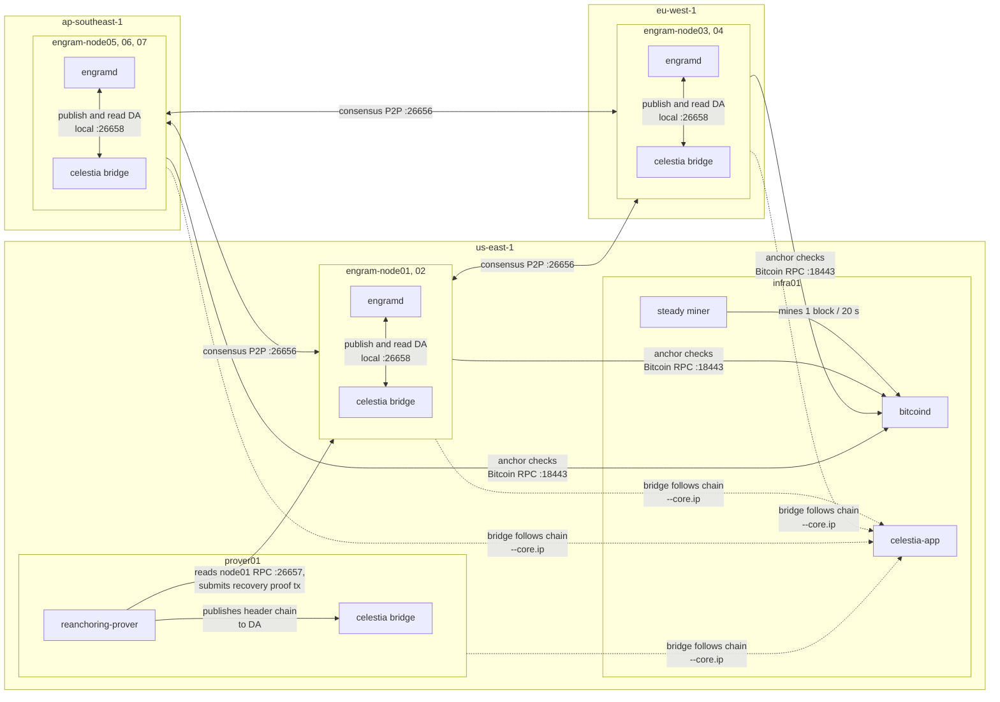

# Multi-host deployment

Runs the Engram testnet on 7 validator VMs plus one infrastructure VM and one prover VM, so experiments see real wide-area
links instead of one machine's Docker network. Use it to reproduce the wide-area results (Testbed B) or to run on your own
hosts.

Bitcoin and Celestia stay a **private regtest node and a single-validator `celestia-app` chain**, as on the single-host
testnet: the experiments inject Bitcoin and DA faults, which mainnet cannot do and would bill in real BTC/TIA. Only the
validator network is real WAN.

Contents: [Architecture](#architecture) · [Prerequisites](#prerequisites) · [Build the images](#build-the-images) ·
[AWS setup](#aws-setup) · [Deploy](#deploy) · [Run the experiments](#run-the-experiments) ·
[Prover check](#prover-check) · [Redeploy and tear down](#redeploy-and-tear-down) ·
[WAN specifics](#wan-specifics) · [Run plan](#run-plan) · [Unattended runs](#unattended-runs) ·
[Troubleshooting](#troubleshooting)

## Architecture

```
infra01   Bitcoin regtest node + steady miner, celestia-app
prover01  ZK re-anchoring prover + its own Celestia bridge (own CPU: proving must not compete with Bitcoin or consensus)
engram-node01..07   engramd + that validator's own Celestia bridge (independent DA observation)
```



- **Bitcoin.** One regtest `bitcoind` and a steady miner on `infra01` (mining must stay steady, `CLAUDE.md`); every
  validator's anchor tracker calls `infra01:18443`.
- **Celestia.** One private `celestia-app` chain on `infra01`. Each validator host runs its **own** bridge following it
  (`--core.ip infra01`), giving each validator an independent DA view; a DA outage is injected by stopping the bridges.
  Bridge accounts are funded one at a time, since a single funding account races on sequence numbers.
- **Validators.** One `engramd` per host. The controller generates the genesis and per-node keys (public addresses and
  `engram_params` baked in) and copies only a node's own home to it. P2P uses `ansible_host` addresses; RPC `:26657` is
  open only to `operator_cidrs`, `infra01` and `prover01`.
- **Prover.** On `prover01`, in the region of `infra01` and `engram-node01` (whose RPC it polls). It builds recovery proofs
  and submits them as transactions; it is not a validator. Without a `prover` host in the inventory it runs on `infra01`
  (smaller deployments).
- **Controller.** Your machine: builds `engramd` and the genesis, runs the playbooks and the experiment scripts.
- **Time.** `chrony` on every host; block timestamps are medians of validator clocks.

```
deploy/
├── terraform/aws/          AWS stack; its `inventory` output feeds make-inventory.py
├── bin/make-inventory.py   terraform output -> ansible inventory
├── bin/build-push-images.sh
└── ansible/                provider-independent; works on any 8 or 9 SSH-reachable Linux hosts
    ├── site.yml  teardown.yml  status.yml
    ├── inventory/example.yml
    ├── group_vars/all.yml  every tunable, documented in place
    └── roles/{controller,common,infra,bridge,engramd,prover}
```

Terraform is optional: Ansible only needs an inventory, so any cloud, bare metal or testbed works. Copy
`inventory/example.yml` to `inventory/hosts.yml`; `ansible_host` is the address other hosts use to reach that machine,
`node_index` runs 1..N without gaps, and the `prover` group is optional.

## Prerequisites

On the controller (also where the experiment scripts run):

- Go, `ansible-core` >= 2.15, `tar`, Docker, and Terraform >= 1.5 if you use the stacks.
- An SSH key pair. Hosts: Ubuntu 22.04/24.04 or Debian 12, amd64, public IPv4.

| Host | vCPU / RAM | Why |
|---|---|---|
| each validator | 2 / 8 GB | `engramd` and a Celestia bridge |
| `infra01` | 4–8 / 8–16 GB | Bitcoin, miner, `celestia-app` |
| `prover01` | 8 / 16 GB | one proof peaks at about 7.5 GB; `nargo execute` is single-threaded, `bb prove` uses all cores. `bb` is OOM-killed below about 8 GB |

## Build the images

Nothing is built on a VM, and nothing outside this repository is needed: `go.mod` pins the CometBFT fork
(`engram-consensus-core`) to a commit, and the Dockerfiles check the `bb` and `nargo` downloads against pinned SHA-256
hashes. `bin/build-push-images.sh` builds the two images (`engram-node`, with `engramd` and the pinned `bb`, and
`engram-reanchoring-prover`) for `linux/amd64` and pushes them to Docker Hub tagged with the commit; hosts only pull.
Bitcoin, `celestia-app` and the bridges come from their public registries.

**Build on a native `amd64` machine.** Under emulation (an Apple Silicon Mac) the `amd64` `bb` and `nargo` crash with
SIGILL, so the build fails. Use either:

- **CI (no cost, nothing to set up on a machine).** `.github/workflows/images.yml` builds and pushes both images on an
  `amd64` runner. Add the repository secrets `DOCKERHUB_USERNAME` and `DOCKERHUB_TOKEN` (a Docker Hub access token with write
  access to the two repositories), then run the workflow from the Actions tab or push a tag named `release-*`. The run
  summary lists the image digests and the commits.
- **Any amd64 machine**, or a remote builder (`docker buildx create --name amd64 ssh://user@host`, then `BUILDER=amd64`):

```bash
docker login
export DOCKERHUB_USER=<your Docker Hub user>
deploy/bin/build-push-images.sh              # prints: export ENGRAM_IMAGE_TAG=<commit>
```

Then, for the playbooks:

```bash
export ENGRAM_IMAGE_TAG=<that commit>        # the playbooks refuse to run without it and DOCKERHUB_USER
export DOCKERHUB_TOKEN=<read-only token>     # only for a private repository
```

The script refuses to build when tracked files differ from the commit (`ALLOW_DIRTY=1` overrides) and prints the
`engram-consensus-core` commit it contains; `CHECK_ONLY=1` only lints the Dockerfiles; `PLATFORM=linux/arm64` builds
natively on Apple Silicon for local checks. Record both commits with the results. `scripts/verify_zk_assets.sh` checks
that the embedded verifier and verification keys match `x/sovereignty/keeper/zk_assets/ASSETS.lock`.

## AWS setup

Everything runs on the controller. Terraform and the AWS CLI share credentials; Ansible reaches the VMs over SSH and never
calls AWS. Regions are the stack defaults (`regions` in `terraform/aws/main.tf`).

```bash
export REGIONS="us-east-1 eu-west-1 ap-southeast-1"
```

**1. Account, regions and credentials.** A new "AWS (new)" account starts on the Free plan: one project, one region,
enforced by an AWS-managed service control policy (SCP) that denies every other region (and EC2 in us-east-1 and
us-west-2). The Paid plan does not lift it; activating advanced features and detaching that SCP does.

1. *Activate advanced features* (AWS Settings; irreversible). The project becomes a member account of an organization, its
   spend limit is deleted (step 4's alert is then the only guard), and the email you enter becomes the management account's
   root user: use a mailbox you control, not a relay address. Credits move to the management account.
2. *Detach the region SCP.* In the management account: AWS Organizations > Policies > Service control policies >
   `AdvancedModeRegionRestrictionSecurityControlPolicy` > Targets, select Root, Detach (never delete). Keep `FullAWSAccess`
   and `ManagedAccountSecurityControlPolicy`; `BudgetsSpendLimitDenyNewWorkloads` must have no targets (it blocks new
   chargeable resources).
3. *Credits.* Shown under Billing and Cost Management > Credits in the management account. Billing preferences > Credit
   sharing preferences must list the member account as Activated (the default), otherwise its usage bills the card.
4. *IAM user,* in the member account (not the management account): IAM > Users > Create user without console access, then
   Security credentials > Create access key (command line). `AdministratorAccess` is simplest for a single-owner research
   account; `AmazonEC2FullAccess` suffices for Terraform alone, and the quota and budget calls also need
   `servicequotas:*` and `budgets:*`. Delete the key after the experiments.

Run `aws configure` in an interactive terminal; it prompts for the key and secret, so they never appear on the command line.

```bash
aws configure --profile engram        # region us-east-1, output json
export AWS_PROFILE=engram
aws sts get-caller-identity           # must print the member account id and the IAM user
export ACCOUNT_ID=$(aws sts get-caller-identity --query Account --output text)
```

Keys stay in `~/.aws/credentials`, never in the repository.

**2. Regions and instance types.** Every region must offer `m5.large`; the `infra01`/`prover01` region also `c5.2xlarge`. A
region disabled by default fails with `AuthFailure` (enable it under Account > AWS Regions); `explicit deny in a service
control policy` means the region SCP of step 1 is still attached.

```bash
for r in $REGIONS; do
  echo "== $r"
  aws ec2 describe-instance-type-offerings --region $r --location-type region \
    --filters Name=instance-type,Values=m5.large,c5.2xlarge --query 'InstanceTypeOfferings[].InstanceType' --output text
done
```

**3. vCPU quota.** "Running On-Demand Standard instances" (`L-1216C47A`) is counted per region and must cover the region's
VMs: 2 vCPU per validator, 8 for `infra01`, 8 for `prover01`. With the default layout: us-east-1 **20** (8 + 8 + 2
validators), eu-west-1 4, ap-southeast-1 6.

```bash
for r in $REGIONS; do
  echo -n "$r  "; aws service-quotas get-service-quota --service-code ec2 --quota-code L-1216C47A --region $r --query 'Quota.Value' --output text
done
aws service-quotas request-service-quota-increase --service-code ec2 --quota-code L-1216C47A --desired-value 24 --region us-east-1
aws service-quotas list-requested-service-quota-change-history-by-quota --service-code ec2 --quota-code L-1216C47A \
  --region us-east-1 --query 'RequestedQuotas[].[Status,DesiredValue,Created]' --output table
```

Small increases are often approved within minutes; others open a support case (up to two days), so request them before the
first deploy, stating the purpose (academic experiment, about two days).

**4. Budget alert.** It warns but does not stop spending. `IncludeCredit: false` tracks gross usage, so it fires while
credits still pay. The limit is the $75 cap; alerts fire at $30 (a 15-20 h run), at $60, and when the forecast passes $75.
Budget data lags by hours; the credit balance has no CLI call (Billing > Credits).

```bash
cat > /tmp/budget.json <<'EOF'
{"BudgetName": "engram-run", "BudgetType": "COST", "TimeUnit": "MONTHLY",
 "BudgetLimit": {"Amount": "75", "Unit": "USD"}, "CostTypes": {"IncludeCredit": false, "IncludeRefund": false}}
EOF
cat > /tmp/notifications.json <<'EOF'
[{"Notification": {"NotificationType": "ACTUAL", "ComparisonOperator": "GREATER_THAN", "Threshold": 40, "ThresholdType": "PERCENTAGE"},
  "Subscribers": [{"SubscriptionType": "EMAIL", "Address": "<your email>"}]},
 {"Notification": {"NotificationType": "ACTUAL", "ComparisonOperator": "GREATER_THAN", "Threshold": 80, "ThresholdType": "PERCENTAGE"},
  "Subscribers": [{"SubscriptionType": "EMAIL", "Address": "<your email>"}]},
 {"Notification": {"NotificationType": "FORECASTED", "ComparisonOperator": "GREATER_THAN", "Threshold": 100, "ThresholdType": "PERCENTAGE"},
  "Subscribers": [{"SubscriptionType": "EMAIL", "Address": "<your email>"}]}]
EOF
aws budgets create-budget --account-id $ACCOUNT_ID --budget file:///tmp/budget.json --notifications-with-subscribers file:///tmp/notifications.json
```

**5. Provision.** Per region Terraform creates a key pair, a security group (SSH from `operator_cidrs` only; 26656, 26657,
18443 and 9090 open at the cloud layer, then restricted per peer by `ufw`) and the instances from Canonical's Ubuntu 24.04
AMI. Nothing exists before `apply`, and billing starts there.

```bash
cd deploy/terraform/aws
cp terraform.tfvars.example terraform.tfvars        # operator_cidrs = ["$(curl -s https://checkip.amazonaws.com)/32"]
terraform init && terraform validate
terraform plan -out=tfplan                          # expect 9 instances, 3 key pairs, 3 security groups
terraform apply tfplan
../../bin/make-inventory.py .                       # writes ansible/inventory/hosts.yml
```

Useful variables: `validator_slots` (placement over `regions`), `infra_slot` (region of `infra01` and `prover01`),
`prover_dedicated` (`false` runs the prover on `infra01`), and `validator_instance_type`, `infra_instance_type`,
`prover_instance_type`. Keep `terraform.tfstate`: `destroy` works from it, from this directory on this machine. If your
public IP changes, edit `operator_cidrs` and apply again.

**6. Check.** `ssh -i ~/.ssh/id_ed25519 ubuntu@<ip>` must work on every host before `site.yml`; otherwise the key pair or
`operator_cidrs` is wrong.

```bash
for r in $REGIONS; do
  aws ec2 describe-instances --region $r --filters "Name=tag:Name,Values=engram-*" Name=instance-state-name,Values=pending,running \
    --query 'Reservations[].Instances[].[Tags[?Key==`Name`]|[0].Value,InstanceType,State.Name,PublicIpAddress]' --output table
done
```

**Cost.** At on-demand prices (verify them in the AWS price list; roughly $0.10/h for an `m5.large` and $0.34/h for a
`c5.2xlarge` in `us-east-1`) the nine hosts cost about $1.4/h before storage and data transfer. A stopped instance still
bills its volume and public IPv4: destroy rather than stop between sessions.

```bash
aws ce get-cost-and-usage --region us-east-1 --granularity DAILY --metrics UnblendedCost \
  --time-period Start=<yyyy-mm-dd>,End=<yyyy-mm-dd> --group-by Type=DIMENSION,Key=SERVICE \
  --query 'ResultsByTime[].Groups[].[Keys[0],Metrics.UnblendedCost.Amount]' --output table   # Cost Explorer: $0.01 per call, lags a day
```

**Tear down and confirm nothing is left.** All three lists must be empty.

```bash
cd deploy/terraform/aws && terraform destroy
for r in $REGIONS; do
  aws ec2 describe-instances --region $r --filters "Name=tag:Name,Values=engram-*" Name=instance-state-name,Values=pending,running,stopping,stopped --query 'Reservations[].Instances[].InstanceId' --output text
  aws ec2 describe-key-pairs --region $r --query 'KeyPairs[?starts_with(KeyName, `engram-key`)].KeyName' --output text
  aws ec2 describe-security-groups --region $r --filters "Name=group-name,Values=engram-*" --query 'SecurityGroups[].GroupId' --output text
done
```

## Deploy

**1. Configure.** Edit `ansible/group_vars/all.yml` or pass `-e`.

```bash
export BITCOIN_RPC_PASSWORD='<long random password>'
export BITCOIN_RPC_USER=engram_admin                      # optional
export DOCKERHUB_USER=<user> ENGRAM_IMAGE_TAG=<commit>    # see "Build the images"
```

| Variable | Default | Meaning |
|---|---|---|
| `operator_cidrs` | `[]` | who may reach validator RPC (26657) and the Bitcoin RPC (18443): the controller's IP |
| `engram_mode` | `engram` | `engram`, or `vanilla` (plain CometBFT, same hosts and containers; needs a fresh genesis) |
| `prover_enabled` | `true` | run the prover; without it RECOVERING never reaches ANCHORED |
| `prover_continuous` | `true` | prove the next segment as soon as the previous proof is submitted |
| `prover_min_batch` | `16` | headers that must wait before a continuous proof fires |
| `prover_pipeline`, `prover_provers` | `false`, `2` | several proofs in flight; each peaks at about 7.5 GB |
| `miner_interval_s` | `20` | one regtest block every N seconds |

**2. Deploy.**

```bash
cd deploy/ansible
ansible-playbook site.yml -e '{"operator_cidrs":["<controller ip>/32"]}'
```

In order: build `engramd` and generate one genesis and 7 key sets on the controller; install Docker, time sync and the
firewall on every host; start Bitcoin, the miner and `celestia-app`; start the 7 bridges and fund each account one at a
time; start the 7 validators; start the prover and its bridge. Hosts pull images and build nothing. Re-running is safe and
resumes after a failure.

Only each validator's own key directory is copied to its host; `deploy/.generated/` on the controller holds all 7 private
keys, so keep it private and out of git (it is ignored).

**3. Verify.**

```bash
ansible-playbook status.yml     # height, catching_up and peers per validator; Bitcoin height; prover state and last PROOFLOG
```

Healthy means all validators at the same advancing height, 6 peers each, `catching_up=false`, and the FSM reaching ANCHORED
(check with `query_node` in `scripts/framework/logger.py`, or `abci_query` on `/engram.sovereignty.v1.Query/State`).

## Run the experiments

The fault-injection scripts reach the cluster through `scripts/framework/cluster.py`; without these variables they run on the
local Docker testnet.

```bash
export ENGRAM_CLUSTER=ssh
# export ENGRAM_INVENTORY=...        # default: deploy/ansible/inventory/hosts.yml
python3 -u scripts/e9_composite_fault/live_composite_fault.py
```

The controller needs `ansible-inventory`, key-based SSH to every host, passwordless sudo on non-root users, and its own
address in `operator_cidrs` (RPC goes straight to each validator's public address).

| Fault | SSH-mode implementation |
|---|---|
| DA outage | `docker stop celestia-bridge` on all validators at once |
| Checkpoint-submission pause | `touch` the pause file in each `engramd` container |
| BTC congestion (`btc_delay`) | `tc netem delay 500 ms ± 100` on `infra01`, only for traffic from Bitcoin's RPC port |
| P2P churn (`p2p_loss`) | `tc netem loss 5%` on node01/node02, only for CometBFT P2P (26656) traffic |
| WAN-realism profile | skipped: the links are already a real WAN |

Scripts not yet routed through `CLUSTER` (E2–E5, E7, E8, E10, the sensor-mismatch and throughput scripts, and
`e6_zk_reanchoring_benchmark/live_prover_tail.py`) use `docker`/Pumba directly and work only on the local testnet.

## Prover check

Run before the composite runs. The recovery gate accepts a proof only while the unproven tail (tip height minus the last
height the accepted proof covers) is at most `MaxUnprovenTailBlocks` (128 in the paper runs). Right after a proof lands the
tail equals `r · L` (`r` the block rate, `L` the seconds from the prover's query to the accepted submission) and then grows
by `r` per second until the next proof, so a sequential prover keeps the tail below `r · 2L`.

```bash
ssh ubuntu@<prover01> 'docker logs reanchoring-prover 2>&1 | grep PROOFLOG | tail -5'
```

`PROOFLOG` fields: start epoch, headers covered, first and last covered height, tracked headers at the query, tip at the
query and at acceptance, seconds per stage (boundary witness, header linking, `nargo execute` + `bb prove`, DA publish,
submit), and the total. The total is `L` on a sequential prover's last line.

| Observed `L` (r ≈ 0.8 blocks/s) | Tail bound `r · 2L` | Action |
|---|---|---|
| ≤ 65 s | ≤ about 105 | proceed |
| 65–110 s | 105–175 | the bound of 128 is not safe: report the tail, or redeploy the prover with `-e prover_pipeline=true -e prover_provers=2` (3 or 4 if needed; about 7.5 GB per proof) |
| > 110 s | > 175 | stop and report; the bound cannot hold |

The scheduling (one proof per worker, the order of submissions, cancelling and restarting after a failure) is tested without a cloud by
`scripts/reanchoring_prover/test_remote_prove.sh` and `test_pipeline.sh`, which also run in CI.

On a shared 10-core workstation `L` is about 117 s (the prover competes with the chain); alone on it the proving steps take
about 55 s. Report `L` and the host type with every recovery result.

## Redeploy and tear down

A fresh chain needs a fresh genesis: a persisted `priv_validator_state.json` without a matching WAL trips FilePV's
anti-double-sign guard (`CLAUDE.md`).

```bash
ansible-playbook teardown.yml -e wipe_generated=true     # stops containers, deletes volumes, node homes and genesis
ansible-playbook site.yml ...
```

`terraform destroy` and the leftover check are under "AWS setup", Tear down.

## WAN specifics

- **P2P latency bound.** `ENGRAM_PARAM_MAX_PEER_LATENCY` defaults to 200 ms, below real inter-continent RTT, so a WAN cluster
  would report unhealthy P2P and never stay ANCHORED. `group_vars/all.yml` sets 500 ms in `engram_params` (baked into
  genesis); report it beside any WAN result.
- **Bitcoin RPC timeout.** `x/anchor` allows each Bitcoin RPC call 800 ms (`rpcTimeout`). Put `infra01` in the most central
  region and keep every validator's RTT to it well below 800 ms, or the BTC sensor reports failures caused by placement.
- **Celestia timing.** `celestia-app` is the same image and timing as on Docker: a block every 11.0 s (sd 0.04 s over 80
  blocks, local cluster), about nine Engram blocks. Each `engramd` reads and publishes DA at its own bridge on
  `127.0.0.1:26658`, so the DA RPC timeout (`ENGRAM_DA_RPC_TIMEOUT_S`, 20 s) and the availability-check timeout
  (`ENGRAM_DA_CHECK_TIMEOUT_MS`, 800 ms) govern a local call and keep their defaults. The WAN hop is bridge to
  `celestia-app` (`--core.ip`): tens to a few hundred ms against an 11 s block. `DAThreshold` stays at 30 Engram blocks. On
  the local cluster the healthy DA gap averaged 12.3 Engram blocks (p95 17, max 18). Record the healthy DA gap (mean and p95)
  of every cloud run; if its p95 approaches 30, report it, and report the relaxed timeouts of
  `scripts/e7_consensus_overhead/run_throughput_fresh.py` (`--da-rpc-timeout-s 90 --da-check-timeout-ms 2500`) as a separate
  arm instead of changing them silently.
- **Infra is a single point.** One host serves Bitcoin and `celestia-app` to all validators; per-validator bridges keep DA
  observations independent, Bitcoin observations are not.

## Run plan

The wide-area cluster answers the single-host objection; it does not repeat the whole evaluation. State the differences
between testbeds in a reviewer-facing table: real RTTs, one host per validator, fixed-performance VMs (no CPU burst credits), a 500 ms peer-latency bound,
one Bitcoin/Celestia instance, a dedicated prover host.

| Item | Setting |
|---|---|
| Hosts | 7 validators in at least 3 regions, `infra01`, `prover01` |
| Composite fault | 5 runs, each on a fresh genesis; proof-only recovery, unproven tail 128 blocks. If the prover cannot meet 128, report the bound used; never change it silently |
| Load | 100 tx/s of small unsigned transactions, Engram against a 7-validator vanilla arm, 3 runs per arm. A load-sensitivity point, not a production workload; 200 tx/s is an optional second point |
| Single fault | Reported from the composite runs (the lock moment after the DA outage or the checkpoint pause) |
| Bitcoin interval | 20 s, as on Docker. Mainnet cadence is not run in the cloud |
| Images | As in "Build the images"; RPC credentials and the Celestia token come from `.env` at run time |
| Budget | At most $75 gross AWS usage and 2 days of rental (hourly cost: "AWS setup", Cost). Tear down right after the last run |
| Reporting | Every run shown next to its mean; 95% intervals use the Student t value for the number of runs (2.78 for five) |

**Before the first deploy,** every input in "Unattended runs" must hold, and the account is set up as in "AWS setup" step 1.

**Phases.**
1. *Deploy (2–4 h).* `terraform apply`, `make-inventory.py`, `site.yml`, `status.yml`. Accept when all 7 validators report the same
   height and reach ANCHORED.
2. *Record the testbed (10 min).* Instance IDs, types and regions, the 9×9 ping RTT matrix, `chronyc tracking` per host, CPU and
   memory. This table describes Testbed B.
3. *Prover check.* As above.
4. *Composite fault × 5.* `ENGRAM_CLUSTER=ssh python3 -u scripts/e9_composite_fault/live_composite_fault.py`, on a fresh
   genesis each time. Compare with the Docker runs: time to SOVEREIGN, time in RECOVERING, AppHash agreement. Keep the prover's
   log of every run (`docker logs reanchoring-prover` on `prover01`).
5. *Load, Engram against vanilla.* 100 tx/s, 3 runs per arm (`-e engram_mode=vanilla` on the same hosts after a fresh genesis).
   The throughput scripts are not yet routed through `CLUSTER`.
6. *Tear down at once.* `terraform destroy`; confirm with the leftover check.

**Stop and report if:** validators stay in SOVEREIGN after 30 min (unfunded bridge or unreachable `celestia-app`), a
validator's RTT to `infra01` exceeds a few hundred ms (the Bitcoin RPC timeout is 800 ms), heights diverge, or the prover
check falls in the last two rows.

## Unattended runs

An agent can run the plan end to end (provision, deploy, run, record, tear down) once every input below exists; a missing
input means stop and ask.

| Input | Check |
|---|---|
| AWS credentials (`AWS_PROFILE`) | `aws sts get-caller-identity` |
| Quota approved in every region | `aws service-quotas get-service-quota ...` per region |
| Budget alert exists | `aws budgets describe-budgets --account-id $ACCOUNT_ID` |
| Spend cap (USD) and rental cap (hours) | the agent stops and destroys when either is reached |
| Images pushed | `docker manifest inspect $DOCKERHUB_USER/engram-node:$ENGRAM_IMAGE_TAG` and the same for `engram-reanchoring-prover` |
| `BITCOIN_RPC_PASSWORD` exported | `test -n "$BITCOIN_RPC_PASSWORD"` |
| `terraform.tfvars` with `operator_cidrs` = this machine | `curl -s https://checkip.amazonaws.com` against the file |
| `engram-consensus-core` pinned to the Docker-run commit | the pseudo-version in `go.mod`'s `replace` line ends with `493a20121caa` |
| Tools | `terraform version`, `ansible --version`, `go version`, `docker info` |
| `terraform validate` and `terraform plan` reviewed before `apply` | the plan shows 9 instances, 3 key pairs, 3 security groups |
| Controller awake and online for the whole run | `caffeinate -dims` on macOS |

**Without asking:** `terraform plan/apply` within the caps, `site.yml`, `status.yml`, the experiment scripts, `teardown.yml`,
pulling logs, and `terraform destroy` at the end or at a cap. **Ask first:** exceeding a cap, changing a run parameter or the
layout, deleting or overwriting a result file, `--force` anything, any console or account setting.

**Record per run:**
- Identity: this repository's commit, the `engram-consensus-core` commit, `ENGRAM_IMAGE_TAG`, `engram_mode`, the Terraform
  layout and the deployment parameters (500 ms latency bound).
- Testbed, once per cluster: as in Run plan, phase 2.
- Raw output: the script's CSV, summary and sensor trace in `scripts/e9_composite_fault/results_live/`, and each host's
  container logs (`engramd`, `celestia-bridge`, the prover) pulled **before** the teardown that deletes them.
- Per run: time to SOVEREIGN, time in RECOVERING, AppHash agreement, the healthy DA gap (mean and p95), prover `L`, and any
  deviation from the plan.
- After the last run: the cost so far and the leftover check.

It does not retry the same failing step more than twice.

## Verification status

Checked offline: the three playbooks pass `ansible-playbook --syntax-check`; the compose templates render for `engram` and
`vanilla`; the firewall rules of all nine hosts evaluate as intended (the prover reaches validator RPC 26657 and
`celestia-app` 26657/9090 only); `terraform validate` passes and `terraform plan` succeeds; the SSH adapter's command construction and inventory parsing are tested against the example inventory with
a stubbed `ssh`.

Not yet run: an `amd64` image build and push, a `docker login` on a host, and any deploy to real hosts. Expect to fix
provider- or distribution-specific details on the first live deploy.

## Troubleshooting

| Symptom | Cause and fix |
|---|---|
| Validators stuck in SOVEREIGN right after deploy | A bridge account is unfunded or `celestia-app` is unreachable: `docker logs celestia-bridge` on the host, rerun `ansible-playbook site.yml --tags fund`. |
| A bridge crash-loops on first start | It lost the one-time `TrustedHash` race (`CLAUDE.md`): `docker compose down -v` in `/opt/engram/node` (`/opt/engram/prover` on `prover01`), then `site.yml --tags bridge,fund,engramd,prover`. |
| `engramd` exits with a double-sign guard error | Stale `priv_validator_state.json` after a partial redeploy: `teardown.yml -e wipe_generated=true`. |
| Peer count below 6 | Firewall: `ufw status` on both ends and the cloud firewall; `ansible_host` must be the address peers dial. |
| Heights advance but the FSM leaves ANCHORED | A validator's RTT to `infra01` or to its peers exceeds the bounds in "WAN specifics". |
| The prover never submits a proof | `docker logs reanchoring-prover` on `prover01`: an unreachable validator RPC (`ufw` on `engram-node01` must allow `prover01` on 26657), an unfunded prover bridge, or a missing `ENGRAM_IMAGE_TAG` image. |
