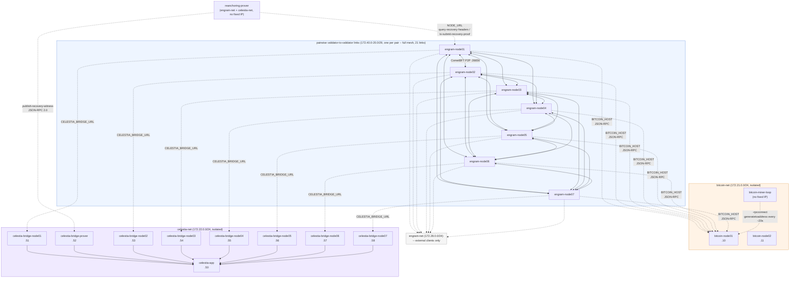

# Infrastructure Architecture

This document describes the REAL, currently-running Docker Compose network/container topology —
validator/Bitcoin/Celestia networking and port allocation. Refreshed whenever the topology changes, verified against
`docker/*.yml` and `docker-compose.yml`.

## 1. Network Topology

Each validator talks to its **own** celestia bridge (`engram-node0N` -> `celestia-bridge-node0N`),
not a shared one — see [`docs/EXPERIMENT.md`](EXPERIMENT.md)'s §3 for why that matters for the
sim-to-real gap. `engram-node-vanilla` (E7's baseline, `.170` on all three networks) is omitted from
the diagram for clarity — it's a real container, not part of the 7-validator consensus set, and its
`CELESTIA_BRIDGE_URL` (pointed at `celestia-bridge-node01`) is inert since `--vanilla` never runs
`RefreshMetrics`.

| Network | CIDR | Gateway | Isolation | Members |
|---|---|---|---|---|
| `validator-link-NN-MM` (×21) | `172.40.<0-20>.0/29` | `.1` | one pair only | the 2 validators of that pair, `.2`/`.3` |
| `engram-net` | `172.28.0.0/24` | `.1` | external clients | 7 validators `.100`/`.110`/`.120`/`.130`/`.140`/`.150`/`.160`, `engram-node-vanilla` `.170`, + `reanchoring-prover` (no fixed IP) |
| `bitcoin-net` | `172.21.0.0/24` | `.1` | isolated | `bitcoin-node01` `.10`, `bitcoin-node02` `.11`, `bitcoin-miner-loop` (no fixed IP), + the same 8 engram containers `.100`-`.170` |
| `celestia-net` | `172.22.0.0/24` | `.1` | isolated | `celestia-app` `.50`, `celestia-bridge-node01` `.51`, `celestia-bridge-prover` `.52`, `celestia-bridge-node02..07` `.53`-`.58`, + the same 8 engram containers `.100`-`.170`, + `reanchoring-prover` (no fixed IP) |

**Key facts:**

* Validators gossip over each peer's literal pairwise-link IP (`cmd/engramd/main.go`'s
  `pairwiseLinkPeerIP`), not an `engram-net` hostname -- this is why `SubnetDiversity`
  (`x/sovereignty/types/subnet.go`'s `SubnetOf`) reads 6 genuinely distinct `/29` subnets per
  validator (one per peer, at 7-node scale), not 1.
* `engram-net` carries everything that isn't P2P gossip: `reanchoring-prover`'s RPC client, the
  attacker swarm (`docs/EXPERIMENT.md`'s §3); validators stay multi-homed onto it alongside their
  pairwise links and `bitcoin-net`/`celestia-net`. It sits on `172.28.0.0/24` to avoid colliding
  with a pre-existing `kind` network on the dev host (`CLAUDE.md`'s M6 notes).
* `bitcoin-miner-loop`/`reanchoring-prover` are real, always-on containers (`make testnet-up`, not
  profile-gated), replacing a host `nohup` process and a manual script invocation. Neither needs a
  static IP -- both only make outbound RPC calls. `reanchoring-prover` writes each accepted proof's
  header-chain witness to its own dedicated `celestia-bridge-prover` -- a **second, separate**
  bridge instance (not one of the 7 per-validator bridges) so the prover's submitter account never
  contends with a validator's own account; sharing one account across submitters caused 3-4
  sequence-mismatch races/sec in practice (`docker/celestia-local-cluster.yml`'s own comment on
  `celestia-bridge-prover`). That witness is an audit trail, never verified on-chain
  (`x/sovereignty/keeper/msg_server.go`'s `RecoveryProofDAHeights`) -- `HeaderHistory` (the on-chain
  copy) gets pruned once the proof lands.
* Profile-gated fault-injection services (attacker swarm, double-signing harness) get extra
  `engram-net` IPs plus their own isolated subnets, only while their Compose profile is active --
  see `docs/EXPERIMENT.md`'s §3 for which profiles exist and what each is used for.

**Routing note:** Docker's default-route ambiguity for multi-homed containers doesn't affect
validator P2P -- each pairwise link is a directly-connected `/29`, so the kernel always routes a
dial to a peer's pairwise-link IP over that link, regardless of default-route priority. It does
matter for off-link traffic (`BITCOIN_HOST`/`CELESTIA_BRIDGE_URL` resolution): declaring
`bitcoin-net`/`celestia-net` after `engram-net` in each service's `networks:` block is what makes
those hostnames resolve at all.

## 2. Port Allocation

Each validator uses offset ports to avoid host collisions -- only **host-mapped** ports differ,
every container listens on the same in-network ports. All 7 validators (+ `engram-node-vanilla`)
are defined in `docker/engram-validator-cluster.yml` (one YAML-anchor-templated file; see it for
the shared base and per-node overrides).

| Node | Engram RPC | Cosmos REST | CometBFT metrics |
|---|---|---|---|
| `engram-node01` | `26657` | `1317` | `26660` |
| `engram-node02` (+100) | `26757` | `1417` | `26760` |
| `engram-node03` (+200) | `26857` | `1517` | `26860` |
| `engram-node04` (+300) | `26957` | `1617` | `26960` |
| `engram-node05` (+400) | `27057` | `1717` | `27060` |
| `engram-node06` (+500) | `27157` | `1817` | `27160` |
| `engram-node07` (+600) | `27257` | `1917` | `27260` |
| `engram-node-vanilla` (+700) | `27357` | `2017` | `27360` |

`CometBFT metrics` is CometBFT's own Prometheus `/metrics` endpoint -- always on, but unscraped: no
prometheus/grafana stack exists here. Every E2-E9 experiment number instead comes from
`scripts/framework/logger.py` polling CometBFT RPC/ABCI-query directly.

| External service | Compose file | Port |
|---|---|---|
| `bitcoin-node01` RPC | `docker/bitcoin-regtest-cluster.yml` | `18443` |
| `bitcoin-node02` RPC | `docker/bitcoin-regtest-cluster.yml` | `19443` |
| `celestia-app` RPC | `docker/celestia-local-cluster.yml` | `27657` (host-mapped to avoid colliding with `engram-node01`'s `26657`; container-internal port is `26657`) |
| `celestia-app` gRPC | `docker/celestia-local-cluster.yml` | `9090` |
| `celestia-bridge-node01` RPC | `docker/celestia-local-cluster.yml` | `26658` |
| `celestia-bridge-prover` RPC | `docker/celestia-local-cluster.yml` | `26668` |
| `celestia-bridge-node02` RPC | `docker/celestia-local-cluster.yml` | `26678` |
| `celestia-bridge-node03` RPC | `docker/celestia-local-cluster.yml` | `26688` |
| `celestia-bridge-node04` RPC | `docker/celestia-local-cluster.yml` | `26698` |
| `celestia-bridge-node05` RPC | `docker/celestia-local-cluster.yml` | `26708` |
| `celestia-bridge-node06` RPC | `docker/celestia-local-cluster.yml` | `26718` |
| `celestia-bridge-node07` RPC | `docker/celestia-local-cluster.yml` | `26728` |

No per-validator "Celestia Light RPC" port exists -- there's no light-client hop in this
deployment; `x/da`'s `Publisher`/`RPCClient` on each validator talk directly to that validator's own
`celestia-bridge-node0N` (matching its own node number, via that node's `CELESTIA_BRIDGE_URL`) --
never a shared bridge.
