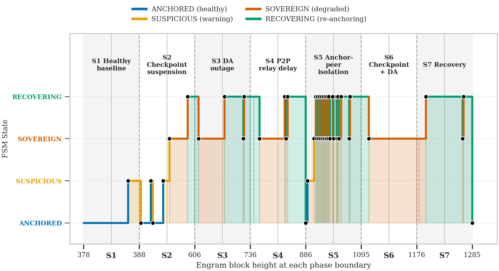
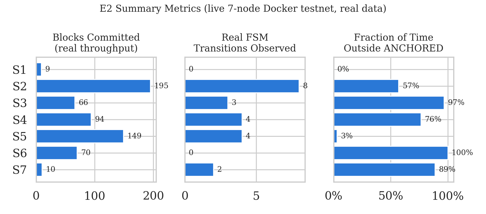
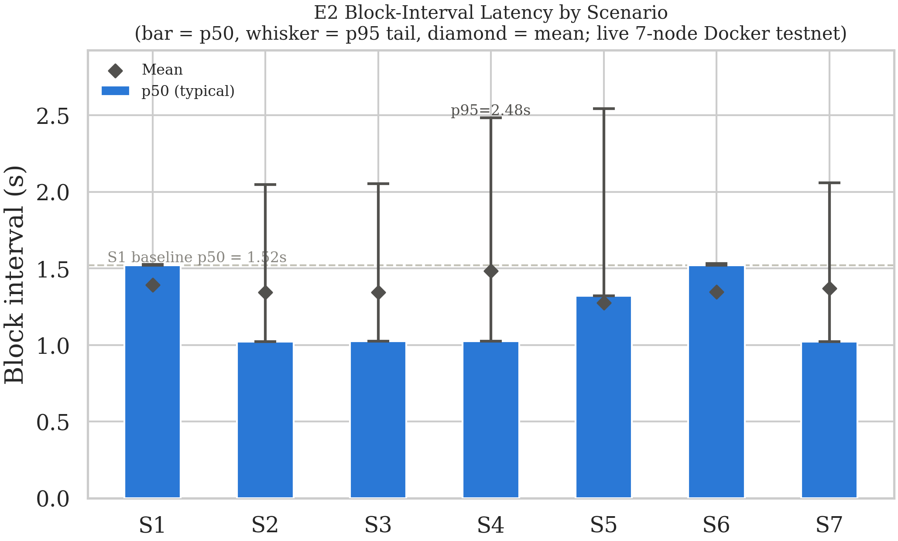
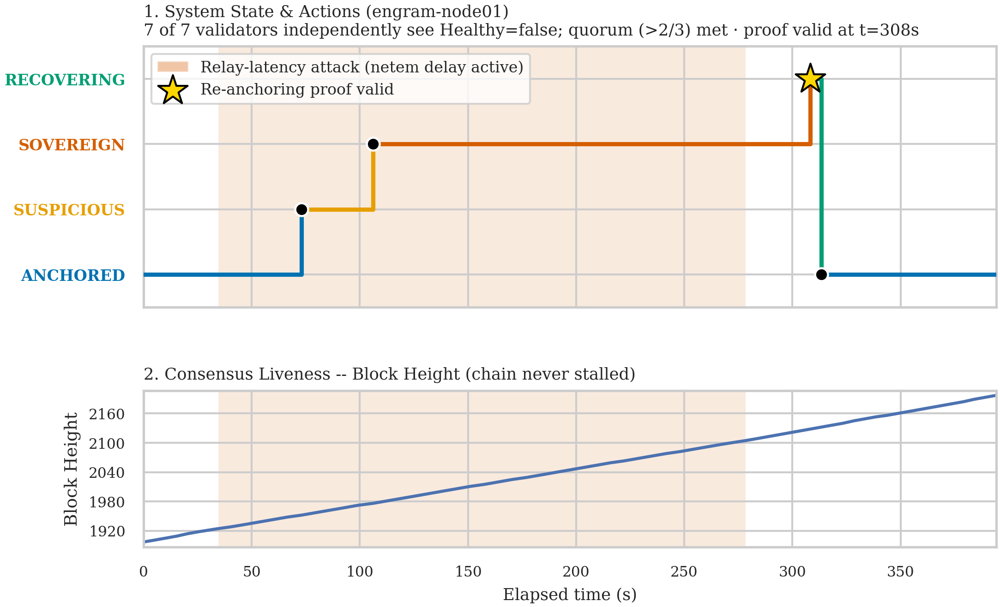
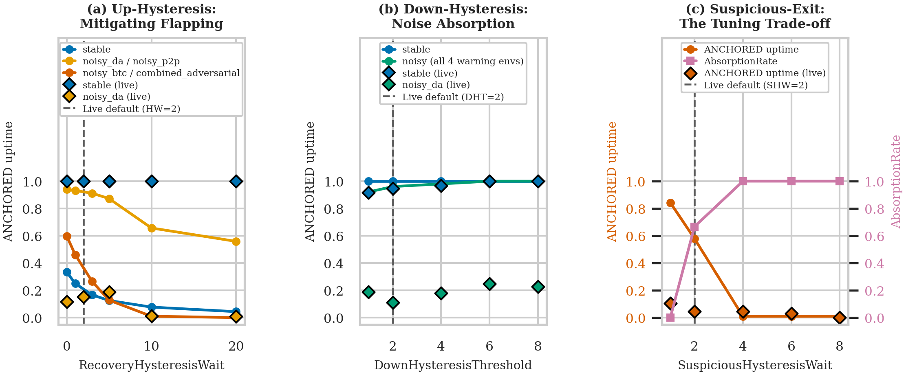
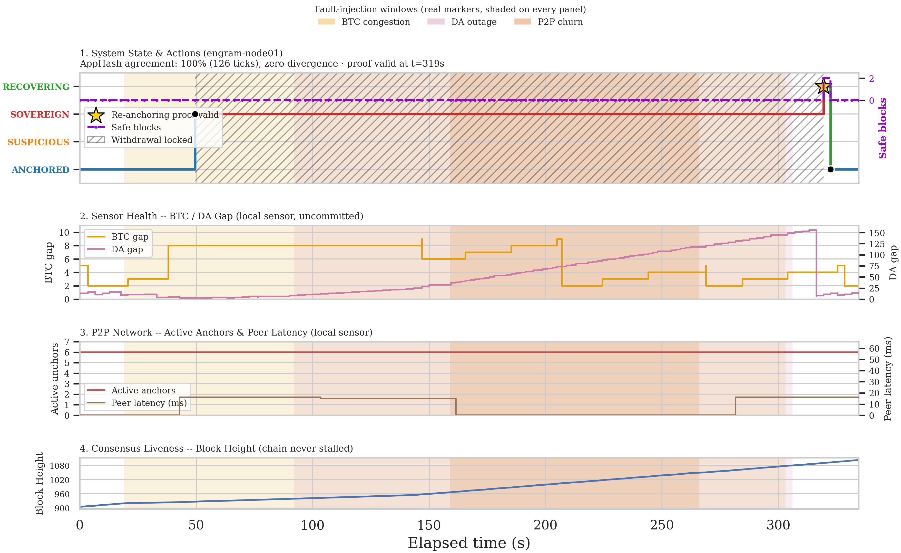
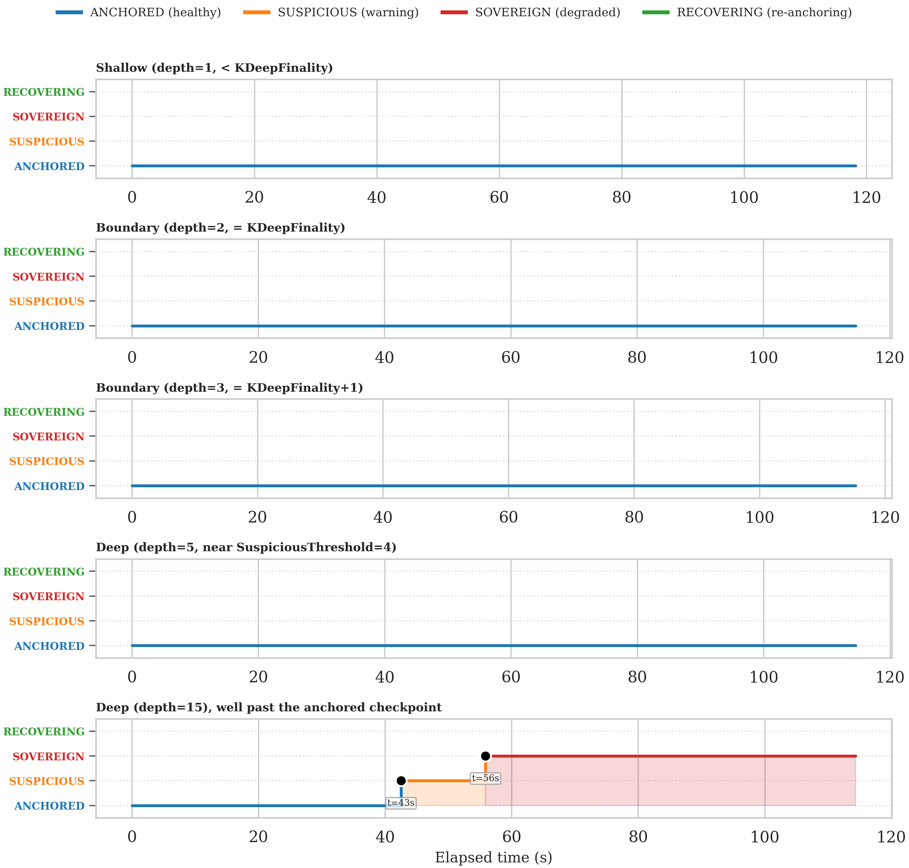

# Experiment Report — Engram Sovereign FSM

> **Goal:** a complete evaluation story for a rank-B-or-above CS conference submission.

The evaluation combines three layers of evidence: formal specification (TLA+), a fault-injection
prototype, and cryptographic/consensus microbenchmarks.

**Contents**

* [1. Research Questions](#1-research-questions)
* [2. Experiment Suite Overview](#2-experiment-suite-overview)
* [3. Experimental Environment](#3-experimental-environment)
* [4. Per-Experiment Design](#4-per-experiment-design)
  * [E1 — Formal Verification Stress & Ablation](#e1--formal-verification-stress--ablation)
  * [E2 — Fault-Injection End-to-End Prototype](#e2--fault-injection-end-to-end-prototype)
  * [E3 — Failure Matrix](#e3--failure-matrix)
  * [E4 — P2P Eclipse/Sybil Detection](#e4--p2p-eclipsesybil-detection)
  * [E5 — FSM Transition Stability](#e5--fsm-transition-stability-hysteresis-across-all-absorb-edges)
  * [E6 — Reanchoring Feasibility Evaluation](#e6--reanchoring-feasibility-evaluation)
  * [E7 — Extended Proposal Consensus Overhead](#e7--extended-proposal-consensus-overhead)
  * [E8 — Attack-Resilience Test Suite](#e8--attack-resilience-test-suite)
  * [E9 — Scripted Composite-Fault Stress Test](#e9--scripted-composite-fault-stress-test)
  * [E10 — Bitcoin Reorg Fork-Choice Reaction](#e10--bitcoin-reorg-fork-choice-reaction)
* [5. Figures & Tables Needed in the Paper](#5-figures--tables-needed-in-the-paper)
* [Conclusion](#conclusion)

---

## 1. Research Questions

Four research questions drive the evaluation — they turn this from "a fallback FSM for modular
blockchains" into a claim backed by evidence under real Bitcoin-settlement, DA-layer, and P2P
failures.

| # | Question | What it evaluates |
|---|---|---|
| RQ1 | Safety | Does folding peripheral state into the consensus proposal prevent block/FSM-state conflicts, forged receipts, data withholding, and withdrawal leakage? |
| RQ2 | Liveness | Under Bitcoin/DA failure or peripheral/partial P2P degradation (core quorum connectivity intact), does the system keep committing blocks where a hard-gated modular baseline (block validity requires BTC/DA receipts) stalls? Vanilla CometBFT is only the control: it never depends on either layer. |
| RQ3 | Recovery | Once peripherals recover, do hysteresis and the re-anchoring proof bring the chain back to a stable ANCHORED without flapping? |
| RQ4 | Cost | What overhead do the extended proposal, sensor validation, circuit breaker, and ZK re-anchoring add versus the CometBFT/Cosmos SDK baseline? |

---

## 2. Experiment Suite Overview

| Group | Scientific goal | Baseline | Metrics |
|---|---|---|---|
| **E1** Formal verification stress & ablation | Prove safety/liveness holds beyond one small config | Full FSM vs. removing hysteresis / P2P sensor / f+1 pacemaker / ZK proof gate | States generated, distinct states, depth, violations found, counterexample class |
| **E2** Fault-injection end-to-end prototype | Show the fallback keeps the chain alive under BTC/DA failure or peripheral/partial P2P degradation (core quorum connectivity intact) | Static circuit breaker; FSM without hysteresis; peer-count-only P2P sensor. The liveness comparison against a chain that hard-requires BTC/DA receipts is **E11** | Block commit rate, time-to-SOVEREIGN, committed tx during outage, downtime, recovery time |
| **E3** External-dependency failure matrix | Evaluate each failure and combinations | Same as E2 | Expected FSM state, withdrawal policy, block-production mode per health combination (a lookup table, not a scalar metric — see §4) |
| **E4** P2P eclipse/Sybil detection | Test whether the tri-interface profiler beats a peer-count sensor | Peer-count-only detector | FPR/FNR, detection delay, incorrect recovery attempts |
| **E5** FSM transition stability across all absorb edges | Show every hysteresis-gated edge (RECOVERING→ANCHORED, ANCHORED→SUSPICIOUS, SUSPICIOUS→ANCHORED) resists flapping under natural noise | Each sweep's own floor value (`RECOVERY_HYSTERESIS_WAIT=0`, `DownHysteresisThreshold=1`, `SuspiciousHysteresisWait=1`) — the edge transitions on a single reading, no absorption | Anchored uptime, flapping/transition counts, withdrawal-locked time, absorption rate, time-outside-ANCHORED |
| **E6** Re-anchoring feasibility | Show the recovery proof is practical and scalable | Noir+Honk vs. Plonky3; no-ZK baseline (re-execute) | Constraint count, proving/verification time, proof size, backend trade-off |
| **E7** Consensus overhead benchmark | Measure the cost of the extended proposal fields | Vanilla proposal | Proposal size, CPU validation cost, throughput, block latency |
| **E8** Attack-resilience scenarios | Demonstrate the security story empirically | Malicious proposer; data withholding; forged BTC receipt; withdrawal during SOVEREIGN; censorship | Accepted/rejected proposals, invalid commit count, forced-inclusion latency |
| **E9** Scripted composite-fault stress test | Confirm the chain keeps committing under a layered, overlapping multi-fault sequence | Synthetic-only experiment | FSM state timeline, block commit rate, withdrawal-lock/proof-generation status under layered BTC congestion + DA outage + P2P churn |
| **E10** Bitcoin reorg fork-choice reaction | Test whether the FSM reacts correctly to a real Bitcoin reorg invalidating an anchored checkpoint | Shallow reorg (below `KDeepFinality`) vs. deep reorg (past the anchored checkpoint) | FSM state transition (ANCHORED vs. SOVEREIGN), reaction correctness vs. reorg depth |
| **E11** Hard-gated baseline liveness | Show Engram keeps committing where a chain that makes BTC/DA receipts part of block validity stalls, without leaking withdrawals | Hard-gated (FSM pinned to ANCHORED) and soft (no withdrawal lock), same binary and fault schedule; vanilla as control | Blocks in fault window, longest block gap, rounds at the stuck height, time to resume, unsafe withdrawals committed |

---

## 3. Experimental Environment

Every "live" result in §4 runs on one real 7-node Docker Compose testnet — a real Cosmos SDK app
(`x/sovereignty`) on a forked CometBFT core (`engram-consensus-core`), not an in-process mock.
Described once here; per-experiment write-ups below only note what's scenario-specific (including
the few results not yet rerun at 7-node scale — noted individually where that's still true).

**Cluster:**

| Component | Real infrastructure |
|---|---|
| Validators | 7 (`engram-node01..07`), real ABCI++ hooks (`PrepareProposal`/`ProcessProposal`/`PreBlocker`) |
| Bitcoin settlement | Real `bitcoind` regtest (2 nodes), continuous miner loop (~1 block/20s) |
| Celestia DA | Real `celestia-app` + 7 independent `celestia-bridge-node01..07`, one per validator — each validator retrieves its own DA view, not one shared bridge for the cluster |
| ZK re-anchoring | Real Noir/Barretenberg prover, watches for a SOVEREIGN backlog, submits real `SubmitRecoveryProof` txs |
| Network | 21 dedicated pairwise `/29` links for validator gossip (full mesh, `C(7,2)`; see [`docs/ARCHITECTURE.md`](ARCHITECTURE.md)), not a shared subnet; separate `engram-net`/`bitcoin-net`/`celestia-net` for everything else |

**Network-level fault injection** (real `tc netem` via [Pumba](https://github.com/alexei-led/pumba), not application-level delay):

| Profile | Real effect | Used by |
|---|---|---|
| `chaos-delay` | 100ms ±20ms jitter, all 7 validators, 5m | general baseline |
| `chaos-loss` | 5% loss, node01+node02, 2m | E2 S4, E9 |
| `chaos-eclipse` | 100% loss, node01 only, 3m | E2 S5 |
| `chaos-crash` | SIGKILL node04 (one-shot) | crash-fault baseline |
| `chaos-btc-delay` | 500ms ±100ms jitter, bitcoin-node01, 2m | E2 S2 (RPC realism only) |
| `chaos-wan-latency` | per-validator delay: 15/70/140/45/100/30/180ms ±3/15/25/10/20/6/30ms, 10m | WAN baseline (E5, E9, others) |
| `chaos-wan-loss` | per-validator loss: 1%/3%/6%/2%/4%/1%/5%, 10m | WAN baseline (loss variant) |

The `chaos-wan-*` pair is the main realism baseline: each validator gets its own real delay/loss
value, simulating 7 distinct regions instead of one shared value for all 7 (node05-07 added when
the cluster scaled from 4 to 7 validators; node01-04's original values are unchanged).

**Application/service-level fault injection**, where network delay alone can't reproduce the real
mechanism:

* **BTC congestion** (E2 S2): `AnchorTracker.SetSubmissionPausedFile` pauses new checkpoint
  submission (a pending one still confirms), growing `btc_gap` directly — `btc_gap` is a
  block-height delta, not an RPC round-trip, so network delay can't reproduce it.
* **DA outage** (E2 S3, E3, E9): real `docker stop`/`start` of celestia bridges — all 7 independent
  per-validator bridges together for a genuine cluster-wide outage (`stop_all_da_bridges`), or just
  `celestia-bridge-node01` where a scenario calls for a single validator's own DA view failing.
* **Combined BTC+DA** (E2 S6): both together.
* **Attacker/Byzantine infra** (E4, E8): non-validator `engramd` containers
  (`docker/attacker-peer-swarm.yml`), a validator faking its own proposal
  (`docker/engram-node04-byzantine.yml`), a second process holding one validator's real key
  (`docker/engram-node04-double-sign.yml`), a validator flooding `Timeout` messages
  (`docker/engram-node04-timeout-flood.yml`).

**Sim-to-real gap.** This setup approximates a real decentralized deployment; it isn't one.

1. **One physical machine.** All containers share CPU/memory/Docker — one problem can hit every
   "validator" at once, unlike real separate machines. Caused a real bug in this work: a
   CPU-contention deadlock (§4's E8, the `x/anchor/verify.go` fix).
2. **~30x faster than real Bitcoin.** ~1 block/20s here vs. ~10 min/block on mainnet. Thresholds
   in blocks (`KDeepFinality`, `SovereignThreshold`) stay valid; wall-clock times in this document
   (e.g. "t=88s") don't — real Bitcoin would take ~30x longer.
3. **Each validator's DA check trusts its own single bridge.** A `blob.GetAll` call to that
   validator's own self-run Celestia bridge, not real light-client sampling across many peers —
   true per-validator even though the cluster no longer has one shared bridge as a single point of
   failure (each of the 7 validators runs its own independent bridge). Deliberate scope choice, but
   DA-outage results (E2 S3, E3, E9) measure a bridge (or all 7 together) going down, not a
   sampling-detected failure. Full detail: `spec/README.md`'s DAS/Blobstream section.

---

## 4. Per-Experiment Design

Each experiment below follows the same five-part structure: **Objective** (which research
question it answers), **Metrics** (what's measured and why), **Method** (the code/command that
produces the measurement), **Results** (real numbers, or explicitly marked not-yet-measured), and
**Conclusion** (the actual finding, including negative results, and what's still open). Tables are
used wherever the content is naturally tabular; bullets otherwise.

### E1 — Formal Verification Stress & Ablation

**Objective:** show FSM safety/liveness holds beyond the one small TLC configuration checked
routinely — across larger quorums/rounds and with individual safety mechanisms deliberately
removed, producing counterexample traces where a mechanism actually matters. Answers RQ1/RQ2's
formal half.

**Metrics**

| Metric | Definition |
|---|---|
| States generated / distinct | TLC's raw + deduplicated state count |
| Depth | longest state-graph path explored |
| Violations found | any invariant/property broken |
| Counterexample class | which property broke, if any |

**Method:** TLC model-checking, 3 configs × 5 ablations, each ablation expected to reproduce a
specific known failure mode.

| Config | N | f | MaxRound | BTC height | Engram height | Goal |
|---|---|---|---|---|---|---|
| C1 | 4 | 1 | 2–3 | 2–3 | 2–3 | reproduce the current result |
| C2 | 4 | 1 | 4–5 | 3–4 | 3–4 | deeper consensus rounds |
| C3 | 7 | 2 | 2–3 | 2–3 | 2–3 | larger quorum overlap |

| Ablation | Expected outcome |
|---|---|
| Remove hysteresis | Flapping or premature recovery |
| Remove P2P health gate | An eclipsed node may trigger recovery incorrectly |
| Remove circuit breaker | Withdrawal-marked transaction proposed during SOVEREIGN/RECOVERING |
| Remove f+1 timeout fast-forward | Liveness delay or round-stall increases |
| Remove DA receipt consistency | A data-withholding proposal may get committed |

**Results:** 

See [§9 Formal Verification stress & ablation](../spec/README.md#9-formal-verification-stress--ablation)

---

### E2 — Fault-Injection End-to-End Prototype

**Objective:** demonstrate graceful degradation instead of halting across 7 failure/recovery
scenarios. Answers RQ2/RQ3.

**Metrics**

| Metric | Status |
|---|---|
| Time-to-detection | Measured |
| Time-to-fallback | Measured |
| Availability during outage | Measured |
| Recovery time | Measured |
| Withdrawals blocked | Measured |
| Flapping / incorrect transitions | Measured (real hysteresis-absorbed blips on S2/S4/S5 at 7-node scale — see Results; none is an incorrect transition) |
| Throughput/latency | Measured live, as a block-interval proxy |

**Method**

| Scenario | Mechanism | Result |
|---|---|---|
| S1 Normal baseline | healthy sensors throughout | Confirmed, live |
| S2 BTC congestion | `AnchorTracker.SetSubmissionPausedFile` | Confirmed, live |
| S3 DA outage | `docker stop celestia-bridge-node01` | Confirmed, live |
| S4 P2P eclipse (partial) | real `netem` delay, 6 validator-link interfaces to/from node01 | Confirmed, live |
| S5 Total anchor isolation | Pumba `chaos-eclipse` (100% loss, node01) | Confirmed live: isolation genuine, transient `SUSPICIOUS` blips absorbed by hysteresis, no sustained escalation (see caveat) |
| S6 Combined BTC+DA | real `docker stop bitcoin-node01`+`celestia-bridge-node01` | Confirmed, live |
| S7 Recovery | failures clear, ZK proof submitted | Confirmed, live |

Live: `scripts/e2_fault_injection/live_scenario_matrix.py`, real 7-node cluster (superseded a
4-node run; see Results). Baselines: static circuit breaker, FSM without hysteresis, FSM with a
peer-count-only P2P sensor. Vanilla CometBFT (`engramd start --vanilla`) is a control only — see
**Vanilla comparison** below; the liveness comparison against a hard-gated chain is **E11**. (Logic validated in-process first
via `go test ./tests/e2e/...`, real `BeginBlocker`, mocked sensors; only live results are reported
here.)

**Results**

Live (864s continuous run, `results_live/s{1..7}_*.csv`): 153 real transitions across all 7
validators, from the 2026-09-01 7-node rerun (supersedes the old 4-node run's 810s/60 transitions).
Times are elapsed seconds since the run started — each scenario picks up where the last one's
recovery left off — with "—" meaning no transition. The table shows each scenario's real
escalation; extra hysteresis-absorbed blips are noted below it:

| Scenario | →SUSPICIOUS | →SOVEREIGN | →RECOVERING | →ANCHORED |
|---|---:|---:|---:|---:|
| S1 Normal | — | — | — | — |
| S2 BTC congestion | 141s | 171s | 264s | 268s |
| S3 DA unavailable | 278s | 308s | 358s | 362s |
| S4 P2P eclipse | 422s | 467s | 534s | 539s |
| S5 Anchor isolation | 623s | — | — | — |
| S6 Combined BTC+DA | — | 748s (direct) | — | — |
| S7 Recovery | — | — | 859s | 864s |

* **S2** briefly touches `SUSPICIOUS` twice before its real escalation (19s→22s, 77s→80s, both
  absorbed back to `ANCHORED`) — hysteresis absorbing real noise mid-scenario, not present in the
  old 4-node run's cleaner cascade. All 7 validators agree on this exact sequence.
* **S4** diverges by one validator: 6 of 7 escalate straight to `SOVEREIGN`; `engram-node07` sees
  one extra absorbed `ANCHORED` blip mid-cascade before converging on the same final sequence — the
  run's only real cross-validator timing difference.
* **S5** is no longer a "no transition" case — see the rewritten caveat below. All 7 validators see
  `ANCHORED→SUSPICIOUS→ANCHORED`, self-healing by 626s and recurring briefly at 684s→687s (twice on
  5 of 7 validators, three times on the other 2), never escalating past `SUSPICIOUS`.

**Figure 3 (live):**




(PDF: [`scripts/e2_fault_injection/results/seven_scenario_timeline.pdf`](../scripts/e2_fault_injection/results/seven_scenario_timeline.pdf), [`figure3_summary_bars_live.pdf`](../scripts/e2_fault_injection/results/figure3_summary_bars_live.pdf).)

Throughput/latency (block-interval proxy, seconds between height increments,
[`results_live/s2e_throughput_latency.md`](../scripts/e2_fault_injection/results_live/s2e_throughput_latency.md)):

| Scenario | Mean | p50 | p95 |
|---|---:|---:|---:|
| S1 Normal| 1.34 | 1.52 | 1.53 |
| S2 BTC congestion | 1.39 | 1.52 | 2.05 |
| S3 DA unavailable | 1.42 | 1.19 | 3.05 |
| S4 P2P eclipse | 1.89 | 1.81 | 4.27 |
| S5 Anchor isolation | 1.44 | 1.52 | 3.04 |
| S6 Combined BTC+DA | 1.30 | 1.52 | 1.54 |
| S7 Recovery | 1.93 | 2.00 | 3.10 |

**Figure 3 (latency, live):**



(PDF: [`scripts/e2_fault_injection/results/figure3_latency_whiskers_live.pdf`](../scripts/e2_fault_injection/results/figure3_latency_whiskers_live.pdf).)

**Caveat on S5.** Isolation is real (node01's RPC timed out ~164s straight, `/net_info`
cross-check). At 7-node scale it now triggers a brief `SUSPICIOUS` blip on all 7 validators — the
4-node run saw none. Losing 1 of 7 peers still doesn't zero out `ActiveAnchors`, so
`IsCriticalCondition` never fires; the dip just gets absorbed by `SuspiciousHysteresisWait` before
it can cross `MaxSuspiciousTime`. Same mechanism as before, just a slightly bigger nudge at this
scale — not enough to force a sustained escalation.

**Vanilla comparison:** structural fact confirmed by `app/app_test.go`'s
`TestNewEngramApp_VanillaSkipsPreBlocker` — vanilla mode never wires `PreBlocker`, so `FSMState`
can never leave genesis `ANCHORED` regardless of real BTC/DA/P2P health. Vanilla has no
dependency on either layer, so it never stalls when they fail and is not a liveness baseline:
RQ2's comparison is Engram against the hard-gated chain in **E11**. Live confirmation pending.

**Conclusion:**

* RQ2/RQ3's graceful-degradation claim is confirmed live for all 7 scenarios. S5 no longer sits
  outside that claim as a "no transition" outlier — at 7-node scale it does react (a transient
  `SUSPICIOUS` dip, twice absorbed), it just never travels far enough to leave `ANCHORED` for good.
  See the S5 caveat for why.

**Insights:**

* The DA check has an escape hatch (`IsDAHealthy`); the BTC check didn't — an asymmetric
  conditional gate between two structurally similar checks is a liveness trap.
* In-process mocked-sensor testing cannot catch this class of bug by construction (no real leader
  rotation, no persisted state a mock can fail to refresh) — both in-process and live layers are
  needed.
* S4 and S5 are still two different mechanisms: S4 always finishes the cascade to `SOVEREIGN`; S5
  only ever dips the signal briefly, never long enough to cross `MaxSuspiciousTime`.
* The absorbed blips on S2/S5 are the first live-Docker proof that hysteresis absorbs real noise —
  previously only shown through E5's synthetic sweeps.

---

### E3 — Failure Matrix

**Objective:** show precisely which (BTC, DA, P2P) health combinations keep committing blocks vs.
lock withdrawals vs. force SOVEREIGN — a policy-correctness claim under RQ1/RQ2, stated as a
lookup table rather than prose.

**Metrics:** expected FSM state, withdrawal policy, and block-production mode per health
combination (the table below, not a scalar metric).

**Method:**

* `scripts/e3_failure_matrix/measure_latency.py` rebuilds the matrix from E2's real S1-S7
  steady-state data (`tests/e2e/results/s*.csv`), not hand-written.
* `scripts/e3_failure_matrix/live_lifecycle_test.py` separately drives one continuous live run
  through every FSM edge via real `celestia-bridge-node01` stop/start.

**Results:**

| # | BTC | DA | P2P | Expected state | Withdrawals | Block production |
|---:|---|---|---|---|---|---|
| 1 | healthy | healthy | healthy | ANCHORED | enabled | full |
| 2 | warning | healthy | healthy | SUSPICIOUS | not locked (forced-tx queue rate-limited via `MaxSuspiciousForcedTxQueue`) | moderate/full |
| 3 | critical | healthy | healthy | SOVEREIGN | locked | full local |
| 4 | healthy | failed | healthy | SUSPICIOUS → SOVEREIGN if sustained | locked once SOVEREIGN | local |
| 5 | healthy | healthy | eclipsed | SUSPICIOUS (partial) / SOVEREIGN (total) | locked once SOVEREIGN | depends |
| 6 | critical | failed | eclipsed | SOVEREIGN | locked | local |
| 7 | recovered | recovered | healthy | RECOVERING → ANCHORED | locked until anchored | full |

Rows 4 and 5 each list two possible outcomes, for different reasons.

Row 4: DA failure by itself can never trigger SOVEREIGN right away (`IsDAHealthy` has no critical
check). It only moves to SOVEREIGN if SUSPICIOUS lasts longer than `MaxSuspiciousTime`. Real
example: E2's S3 reached SOVEREIGN 30s after entering SUSPICIOUS.

Row 5: P2P eclipse works differently — losing every anchor peer (`ActiveAnchors == 0`) triggers
SOVEREIGN immediately (`IsCriticalCondition`), no waiting. A partial eclipse (some peers lost, not
all) only ever reaches SUSPICIOUS.

* In-process: `Harness.Advance()` never stopped or errored in any scenario — "full/local" block
  production is a measured result, not an assumption
  ([`scripts/e3_failure_matrix/results/table2_failure_matrix.md`](../scripts/e3_failure_matrix/results/table2_failure_matrix.md)).
* Live (344s, full lifecycle, all 4 validators in lockstep at every edge):

  | Edge | Time |
  |---|---:|
  | ANCHORED → SUSPICIOUS | 12s |
  | SUSPICIOUS → ANCHORED (quick recovery, no escalation) | 24s |
  | ANCHORED → SUSPICIOUS → SOVEREIGN (gray-failure timeout) | 27s → 58s |
  | SOVEREIGN → RECOVERING | 74s |
  | RECOVERING → SOVEREIGN (regression, brief re-outage) | 80s |
  | → ANCHORED (real recovery via `watch_and_prove.sh`) | 344s |

  Data: [`scripts/e3_failure_matrix/results_live/lifecycle_test_20260812T153523.csv`](../scripts/e3_failure_matrix/results_live/lifecycle_test_20260812T153523.csv) + [`_summary.md`](../scripts/e3_failure_matrix/results_live/lifecycle_test_20260812T153523_summary.md).

  This run only touches `celestia-bridge-node01` (DA), so it directly confirms rows 1, 4, 7. Rows 2/3/5/6
  (BTC, P2P) are live-confirmed instead by E2's S2/S4/S5, which exercise those same mechanisms —
  not re-tested here to avoid duplicating data already measured.

**Conclusion:**

* The policy table is real, reconstructed data confirmed on both an in-process and a live
  full-lifecycle run.
* Includes an edge the original design didn't explicitly plan for (a live regression dip
  mid-recovery) — the matrix holds under real timing, not just as a static design table.
* **Scope of E1–E3 as a body of evidence:** only E1's TLC model-checking
  ([spec/README.md §9](../spec/README.md#9-formal-verification-stress--ablation)) actually proves
  safety/liveness — and only for the abstract model, not the running Go implementation. E2/E3 test
  the real implementation against real faults, which is strong evidence but not a proof. That gap
  is intentional, not an oversight.

---

### E4 — P2P Eclipse/Sybil Detection

**Objective:** show the tri-interface P2P profiler (structural + behavioral + latency) detects
eclipse/Sybil attacks a peer-count-only baseline misses, and that its output is a real consensus
input (via `FilterPeerByAddr`), not just a monitoring signal. Answers RQ1.

**Metrics**

| Metric | Definition |
|---|---|
| FPR / FNR | false positive/negative rate, per attack |
| Detection delay | snapshots/time until the attack is flagged |
| Evasion threshold | max attack intensity (0–1) an adaptive adversary can hide at |

**Method**

| # | Attack |
|---|---|
| A1 | Peer-slot exhaustion |
| A2 | Simulated multi-subnet Sybil |
| A3 | Churn-based rotation |
| A4 | Relay-node latency inflation |

* Synthetic: Monte Carlo (`go test ./tests/e2e/... -run TestE4_P2PDetectorComparison`, 2000
  trials/cell, fixed seed) comparing real `types.IsP2PQualityHealthy` against a peer-count-only
  baseline, at `DefaultParams()`/`production_scale` thresholds. `TestE4_AdaptiveAdversary`
  (oracle-guided binary search, `evasionThreshold`), `TestE4_DistributionSensitivity` (3 ramp
  shapes, 300 trials/shape), and `TestE4_CorrelatedDomainFailure` (simultaneous BTC/DA degradation)
  extend the comparison beyond a single fixed-intensity, linear-ramp, single-domain sample.
* Live A1/A2: `docker/attacker-peer-swarm.yml` (real, non-validator `engramd` containers) +
  `scripts/e4_p2p_eclipse_detection/live_sybil_attack.py`, testing the real ingress filter
  `FilterPeerByAddr`.
* Live A3/A4: `scripts/e4_p2p_eclipse_detection/live_churn_attack.py` /
  `live_relay_latency_attack.py` (7-validator cluster), testing `IsP2PQualityHealthy` and the real
  committed FSM transition path (ingress filtering doesn't apply — see Results below).
* A2 is named "simulated multi-subnet" rather than "BGP hijacking" because real BGP hijacking
  can't be reproduced in Docker — only its consequence (many peers appearing multi-subnet) is
  simulated.

**Results — synthetic:**

Peer-count-only: 0% FPR, 100% FNR on every attack (by design — all 4 preserve clean-peer count),
evasion threshold 1.0 on every attack (never caught, at any intensity or ramp shape). Tri-interface:
0% FPR, 0% FNR on every attack:

| Attack | Detection delay (snapshots) | Evasion threshold |
|---|---:|---:|
| A1 Peer slot exhaustion | 2.23 | 0.17 |
| A2 Simulated multi-subnet Sybil | 1.00 | 0.00 |
| A3 Churn-based rotation | 1.70 | 0.12 |
| A4 Relay-node attack | 2.71 | 0.25 |

(`DefaultParams()`/`production_scale` reproduce identical numbers;
[`table6_p2p_detector_accuracy.md`](../scripts/e4_p2p_eclipse_detection/results/table6_p2p_detector_accuracy.md))

* Across 3 ramp shapes (linear, front-loaded, stealthy-slow): tri-interface's detection delay
  shifts (e.g. A3 churn: 1.0–3.4 steps depending on shape).
* Detection rate holds 300/300 in every shape × attack cell — regardless of shape, tri-interface
  always eventually catches it.
* Peer-count-only stays 0/300 regardless of shape — never catches it, no matter the ramp.
* Both detectors are pure functions of `PeripheralMetrics`' P2P fields, so their verdicts are
  unchanged by simultaneous BTC/DA degradation.
* The full FSM-level `IsHealthyCondition` still catches a P2P attack even when BTC/DA read healthy
  at the same time.

**Results — live** (pairwise-link topology):

* **A1** (10 attackers, shared subnet): filter holds exactly 8/8 (`MaxPeersPerSubnet`), the 3
  honest peers on separate dedicated `/29`s never appear in the attacked subnet's count, FSM state
  unaffected by the attack (baseline/attack/recovery states identical; the cluster happened to be
  running SOVEREIGN at test time, from unrelated BTC/DA conditions), liveness held
  (0.826→0.831→0.843 blocks/s), nil-prevote ratio 0.0 in all 3 phases.
* **A2** (12 attackers, 4 simulated subnets): filter still holds 8/8, liveness held
  (0.812→0.794→0.806 blocks/s), nil-prevote ratio 0.0 in all 3 phases.

([`sybil_attack_a1_20260831T143719_summary.md`](../scripts/e4_p2p_eclipse_detection/results_live/sybil_attack_a1_20260831T143719_summary.md),
[`sybil_attack_a2_20260831T143948_summary.md`](../scripts/e4_p2p_eclipse_detection/results_live/sybil_attack_a2_20260831T143948_summary.md))

* A1/A2 are absorbed at the ingress filter (`FilterPeerByAddr`) before ever reaching the FSM. A3/A4
  target `PeerChurnRate`/`PeerLatency` instead, fields the filter never reads, so they reach
  `IsP2PQualityHealthy` (`x/sovereignty/types/predicates.go`) and can drive a real FSM transition.
* Each validator signs its own sensor snapshot as an ABCI++ vote extension
  (`x/sovereignty/vote_extension.go`), aggregated into a quorum-certified `PeripheralMetrics`
  (`AggregateHealthCertificates`) that `ProcessProposal` cross-checks against the leader's claim; a
  transition commits only once ≥2f+1 voting power's signed observations back it, so a
  minority-visible degradation, however severe, cannot force one — the quorum gate at work, not a
  detection failure.

| | A3 — Churn-based rotation | A4 — Relay-node latency inflation |
|---|---|---|
| Attack | 7-validator cluster; 8× real `docker stop`/`start` cycles (15s down/20s up) on 2 adjacent-rotation proposers | 7-validator cluster; 350ms±50ms netem delay, sustained, on all of node04's real P2P interfaces (not its `bitcoin-net` `eth0`) |
| Sensor reading | `PeerChurnRate` on both attacked nodes well past `MaxChurnRate=5` — correctly detected | Degrades every validator's own RTT measurement to node04 |
| Validators affected | 2 of 7 (~29% voting power) | 7 of 7 (100%) |
| Quorum (>2/3) met? | No | Yes |
| FSM outcome | No committed transition — 2 brief, uniform SUSPICIOUS blips across all 7 nodes traced to unrelated background BTC/DA jitter, not the churn attack (confirmed via an unattacked node's own `PeerChurnRate=0` for the entire run) | Full cascade (timeline below) |

A4 cascade timeline (relative to netem start):

| Event | Time |
|---|---:|
| → SUSPICIOUS | +39s |
| → SOVEREIGN | +72s |
| Held through attack window | +244s |
| Delay cleared → RECOVERING → ANCHORED | +274s→+279s |

**Figure 5 — FSM cascade under the real A4 relay-latency attack (state timeline + block height)**


(PDF: [`p4_relay_cascade_timeline.pdf`](../scripts/e4_p2p_eclipse_detection/results/p4_relay_cascade_timeline.pdf); generated by `scripts/e4_p2p_eclipse_detection/live_figure_builder.py`/`make e4-figures`.)

([`churn_attack_a3_20260901T060505_summary.md`](../scripts/e4_p2p_eclipse_detection/results_live/churn_attack_a3_20260901T060505_summary.md),
[`relay_latency_attack_a4_20260901T061345_summary.md`](../scripts/e4_p2p_eclipse_detection/results_live/relay_latency_attack_a4_20260901T061345_summary.md))

Methodology: A3 uses real container stop/start cycles because netem packet loss doesn't force a
real CometBFT disconnect (`live_churn_attack.py`'s module doc); A4 delays the dedicated P2P
interfaces directly because Pumba's generic `netem delay <container>` silently hits the
container's `bitcoin-net` `eth0` instead (`live_relay_latency_attack.py`'s module doc).

**Conclusion:**

* Tri-interface beats peer-count-only across the full attack-intensity range an adaptive adversary
  could search, across 3 ramp shapes, and independent of concurrent BTC/DA degradation — not just
  at one fixed synthetic point — and the ingress filter it feeds is confirmed live against real
  attacker containers.
* A3/A4 are two halves of one live-confirmed finding about the quorum gate `ProcessProposal`
  implements: the identical class of real, sensor-confirmed P2P degradation is blocked when only a
  minority sees it (A3) and produces a full, correctly-bounded cascade when a supermajority does
  (A4) — not separate detector failures.

---

### E5 — FSM Transition Stability: Hysteresis Across All Absorb Edges

**Objective:** Show that all 3 hysteresis-gated FSM transitions resist "flapping" (fast, repeated
state switching) under normal per-block noise:

* `RECOVERY_HYSTERESIS_WAIT` on `RECOVERING` $\rightarrow$ `ANCHORED`.
* `DownHysteresisThreshold` on `ANCHORED` $\rightarrow$ `SUSPICIOUS`.
* `SuspiciousHysteresisWait` on `SUSPICIOUS` $\rightarrow$ `ANCHORED` (in `CalculateNextState`).

> Out of scope: **Exponential backoff** (`RECOVERING` $\rightarrow$ `SOVEREIGN`,
> `EffectiveDownHysteresisThreshold`). It defends against a timed attacker, not random noise, so
> it belongs in **E8**, not here.

**Metrics**

Not every metric fits every edge — each edge starts from a different state and its hysteresis
mechanism works differently, so a metric that's central to one edge can be redundant, or simply not
apply, on another:

| Metric | Definition | 5a | 5b | 5c |
|---|---|---|---|---|
| `AnchoredUptime` | share of run spent in ANCHORED | core | core | core |
| `FlappingCount` / `TotalTransitions` | `harness.go`'s `ComputeMetrics` | core | core | core |
| `WithdrawalBlocked` | blocks with `WithdrawLocked` true | redundant with uptime | N/A — never locks | priority gap |
| `AbsorbedEvents` / `AbsorptionRate` (`DemotionCount` in 5b, `ExitCount` in 5c) | noise absorbed vs. actually transitioned | N/A — counter reset, not per-event | core | core |
| `TimeOutsideAnchored` / `DemotionCount` | ANCHORED-starting scenarios only | N/A — doesn't start ANCHORED | core | N/A — doesn't start ANCHORED |

**Live vs. in-process — the main finding, all three edges:**

* Each parameter is swept twice: in-process (fixed seed) vs. live (real 7-node cluster, except 5a
  below which is still 4-node data, not yet rerun at 7-node scale).
* The in-process curve is always clean and monotonic; the live one never is — a fresh genesis +
  real network noise per live run can't cancel out the way a fixed seed does.
* Figure 4 below renders this directly (solid line vs. diamond).
* 5b/5c's live checks stop/start all 7 validators' independent celestia bridges together
  (`stop_all_da_bridges`/`start_all_da_bridges`) as their DA-outage noise source, and share a
  `stable`/no-noise control column.



(PDF: [`scripts/e5_hysteresis_flapping/results/hysteresis_tradeoffs.pdf`](../scripts/e5_hysteresis_flapping/results/hysteresis_tradeoffs.pdf).)

* One panel per edge — (a) Up-Hysteresis, (b) Down-Hysteresis, (c) Suspicious-Exit.
* Line = in-process sweep; diamond = live spot-check (same data as the tables below); dashed line
  = `DefaultParams()`'s real value (=2 on all three).
* (c)'s twin axes are 5c's core trade-off: absorbing more noise (`AbsorptionRate` → 100%) speeds
  up the very `SOVEREIGN` escalation absorption is meant to delay (`AnchoredUptime` → ~1%) — no
  live `AbsorptionRate` equivalent exists, so that side stays in-process only.

#### 5a. Up-hysteresis (RECOVERING to ANCHORED)

* *Method:* `TestE5_HysteresisSweep` sweeps `RECOVERY_HYSTERESIS_WAIT` over {0,1,3,5,10,20} × 5 environments
  (critical: `noisy_btc`/`combined_adversarial`; warning: `noisy_da`/`noisy_p2p`; `stable`),
  fixed-seed 20%-per-block noise. Live: each value gets its own genesis
  (`ENGRAM_PARAM_RECOVERY_HYSTERESIS_WAIT`, `docs/DEVELOPMENT.md` §3), real 300s window.

* *Results:* ([`tests/e2e/results/e5_hysteresis_sweep.csv`](../tests/e2e/results/e5_hysteresis_sweep.csv), Figure 4a) `noisy_da`/`noisy_p2p` and
  `noisy_btc`/`combined_adversarial` give identical numbers at every HW — real data, only 3
  distinct behaviors exist among the 5 environments:

  | RECOVERY_HYSTERESIS_WAIT | Environment | ReachedAnchored | FirstAnchoredAt | FinalState | Flapping | Transitions | AnchoredUptime |
  |---:|---|---|---:|---|---:|---:|---:|
  | 0 | stable | true | 3 | ANCHORED | 0 | 3 | 33.33% |
  | 0 | noisy_da / noisy_p2p | true | 3 | ANCHORED | 3 | 7 | 94.12% |
  | 0 | noisy_btc / combined_adversarial | true | 3 | SOVEREIGN | 10 | 53 | 59.80% |
  | 1 | stable | true | 4 | ANCHORED | 0 | 3 | 25.00% |
  | 1 | noisy_da / noisy_p2p | true | 4 | ANCHORED | 3 | 7 | 93.14% |
  | 1 | noisy_btc / combined_adversarial | true | 4 | SOVEREIGN | 12 | 52 | 46.08% |
  | 3 | stable | true | 6 | ANCHORED | 0 | 3 | 16.67% |
  | 3 | noisy_da / noisy_p2p | true | 6 | ANCHORED | 3 | 7 | 91.18% |
  | 3 | noisy_btc / combined_adversarial | true | 6 | SOVEREIGN | 23 | 46 | 26.47% |
  | 5 | stable | true | 8 | ANCHORED | 0 | 3 | 12.50% |
  | 5 | noisy_da / noisy_p2p | true | 10 | ANCHORED | 3 | 7 | 87.25% |
  | 5 | noisy_btc / combined_adversarial | true | 33 | SOVEREIGN | 31 | 42 | 12.75% |
  | 10 | stable | true | 13 | ANCHORED | 0 | 3 | 7.69% |
  | 10 | noisy_da / noisy_p2p | true | 34 | ANCHORED | 3 | 7 | 65.69% |
  | 10 | noisy_btc / combined_adversarial | true | 38 | SOVEREIGN | 35 | 40 | 0.98% |
  | 20 | stable | true | 23 | ANCHORED | 0 | 3 | 4.35% |
  | 20 | noisy_da / noisy_p2p | true | 46 | ANCHORED | 3 | 7 | 53.92% |
  | 20 | noisy_btc / combined_adversarial | false | -1 | SOVEREIGN | 37 | 39 | 0.00% |

  `stable`'s uptime drop (33%→4%) is a fixed-window artifact, not noise: bigger HW just delays the
  first ANCHORED transition (`FirstAnchoredAt` 3→23), leaving less window left to count as uptime.
  Headline number: `noisy_btc` uptime falls 59.8%→0.0% as HW goes 0→20.

  Live spot-check (5×2: HW ∈ {0,2,5,10,20} × {stable, noisy_da}, 300s/run, all 4 validators agreed
  every sample; [`scripts/e5_hysteresis_flapping/results_live/`](../scripts/e5_hysteresis_flapping/results_live/)):

  | RECOVERY_HYSTERESIS_WAIT | Environment | Flapping (300s) | Transitions | Anchored uptime |
  |---:|---|---:|---:|---:|
  | 0 | stable | 0 | 0 | 100.00% |
  | 0 | noisy_da | 4 | 17 | 11.70% |
  | 2 | stable | 0 | 0 | 100.00% |
  | 2 | noisy_da | 13 | 14 | 15.29% |
  | 5 | stable | 0 | 0 | 100.00% |
  | 5 | noisy_da | 7 | 13 | 18.75% |
  | 10 | stable | 0 | 0 | 100.00% |
  | 10 | noisy_da | 11 | 14 | 1.06% |
  | 20 | stable | 0 | 0 | 100.00% |
  | 20 | noisy_da | 11 | 14 | 1.04% |

  `noisy_da` uptime rises HW 0→5 (11.70%→18.75%), then drops to ~1% once HW≥10 — non-monotonic,
  unlike the in-process curve.

* *Conclusion:* a negative result, by design — `IsCriticalCondition` is checked before any
  absorption happens, so critical-level noise skips hysteresis entirely. A bigger `RECOVERY_HYSTERESIS_WAIT`
  is strictly worse against this noise class; not a bug, this is how the mechanism is meant to work.

#### 5b. Down-hysteresis (ANCHORED to SUSPICIOUS)

* *Method:* `TestE5b_DownHysteresisSweep` sweeps `DownHysteresisThreshold` over {1,2,4,6,8}, 4
  warning-level environments + a `stable` control, starting from ANCHORED. Formally specified in
  `spec/core/EngramFSM.tla` (extends `HysteresisSafety`), re-verified by E1's TLC run.

* *Results:* ([`tests/e2e/results/e5b_down_hysteresis_sweep.csv`](../tests/e2e/results/e5b_down_hysteresis_sweep.csv), Figure 4b) all 4 noisy
  environments (`warning_btc`, `noisy_da`, `noisy_p2p`, `combined_warning`) give the same numbers
  at each threshold; `stable` holds 100.00% uptime / 0 flapping at every threshold, as expected:

  | Metric | Threshold=1 | Threshold=2 | Threshold=4 | Threshold=6 | Threshold=8 |
  |---|---:|---:|---:|---:|---:|
  | Flapping | 5 | 1 | 1 | 0 | 0 |
  | Transitions | 6 | 2 | 2 | 0 | 0 |
  | WithdrawalBlocked | 0 | 0 | 0 | 0 | 0 |
  | AnchoredUptime | 92.08% | 96.04% | 98.02% | 100.00% | 100.00% |
  | TimeOutsideAnchored | 8 | 4 | 2 | 0 | 0 |
  | DemotionCount | 3 | 1 | 1 | 0 | 0 |
  | AbsorbedEvents | 16 | 18 | 20 | 21 | 21 |
  | AbsorptionRate | 84.21% | 94.74% | 95.24% | 100.00% | 100.00% |

  Live spot-check (5×2: DHT ∈ {1,2,4,6,8} × {stable, noisy_da}, 300s/run, real 7-node cluster):

  | DownHysteresisThreshold | Environment | Flapping (300s) | Transitions | Anchored uptime | Time Outside Anchored | Demotion Count |
  |---:|---|---:|---:|---:|---:|---:|
  | 1 | stable | 9 | 10 | 91.75% | 8 | 5 |
  | 1 | noisy_da | 4 | 17 | 18.84% | 56 | 6 |
  | 2 | stable | 9 | 10 | 94.74% | 5 | 5 |
  | 2 | noisy_da | 3 | 21 | 10.96% | 65 | 5 |
  | 4 | stable | 5 | 6 | 96.63% | 3 | 3 |
  | 4 | noisy_da | 0 | 20 | 17.91% | 55 | 6 |
  | 6 | stable | 0 | 0 | 100.00% | 0 | 0 |
  | 6 | noisy_da | 4 | 17 | 24.64% | 52 | 6 |
  | 8 | stable | 0 | 0 | 100.00% | 0 | 0 |
  | 8 | noisy_da | 2 | 14 | 22.73% | 51 | 4 |

  * All 7 validators agree exactly at most values; a few noisy_da/stable rows split (e.g. 6/7 or
    4/7 agreeing, one or two nodes off by ±1 transition/±1-2pp uptime) — the same fixed-interval
    polling artifact the module doc already documents, not a real disagreement. Table shows the
    majority value.
  * `stable` is clean (0 flapping, 100% uptime) only at threshold≥6 — real WAN jitter alone (the
    `chaos-wan-latency` baseline every live run holds, now with a wider 15-180ms per-validator
    spread across all 7 nodes) trips flapping up through threshold=4, a stronger requirement than
    an earlier 4-node measurement found.

* *Conclusion:*
  * Clean, positive result in-process — tested against exactly the noise level it's meant to absorb.
  * Live: `noisy_da` uptime is lowest at threshold=2 (10.96%), highest at threshold=6 (24.64%) — not
    monotonic, consistent with the in-process trend's general shape but not identical to it.
  * Live-only finding, now stronger at 7-node scale: thresholds 1, 2, and even 4 all flap under real
    WAN jitter alone with zero injected noise — only threshold≥6 is clean. A real argument for
    running above `DefaultParams()`'s value (2) in this specific WAN-realism regime, not just above
    the floor.

#### 5c. Suspicious-exit hysteresis (SUSPICIOUS to ANCHORED)

* *Method:* `TestE5c_SuspiciousExitHysteresisSweep` sweeps `SuspiciousHysteresisWait` over
  {1,2,4,6,8}, starting from SUSPICIOUS — the "Gray Failure Arbitrage" attack shape this defends
  against. Formally specified (`SuspiciousHysteresisSafety`); a full-spec TLC re-check (with
  down-hysteresis and backoff) is still pending.

* *Results:* ([`tests/e2e/results/e5c_suspicious_exit_sweep.csv`](../tests/e2e/results/e5c_suspicious_exit_sweep.csv), Figure 4c) a real gap: this test
  never tracks `WithdrawalBlocked`, even though SHW≥4 forces SOVEREIGN partway through the run —
  exactly when withdrawals should lock:

  | Metric | SHW=1 | SHW=2 | SHW=4 | SHW=6 | SHW=8 |
  |---|---|---|---|---|---|
  | FinalState | ANCHORED | ANCHORED | RECOVERING | RECOVERING | RECOVERING |
  | ReachedSovereign | false | false | true | true | true |
  | Flapping | 29 | 9 | 8 | 8 | 8 |
  | Transitions | 30 | 10 | 11 | 11 | 11 |
  | AnchoredUptime | 43.14% | 16.67% | 0.98% | 0.98% | 0.98% |
  | ExitCount | 15 | 5 | 0 | 0 | 0 |
  | AbsorbedEvents | 0 | 16 | 6 | 6 | 6 |
  | AbsorptionRate | 0.00% | 76.19% | 100.00% | 100.00% | 100.00% |
  | MaxSuspiciousDuration | 10 | 22 | 24 | 24 | 24 |
  | WithdrawalBlocked | not tracked | not tracked | not tracked | not tracked | not tracked |

  * `AbsorptionRate` rises 0%→100% as SHW goes 1→4, but `suspicious_duration` keeps accumulating
    and hits `MaxSuspiciousTime`(24) partway through once SHW≥4 — forcing SOVEREIGN regardless of
    SHW.
  * Only SHW=1 and SHW=2 stay under that cap and actually reach ANCHORED.

  Live spot-check (5×2: SHW ∈ {1,2,4,6,8} × {Sustained Warning, 20% Healthy Blips}, 300s/run, real
  7-node cluster; each run first stops all 7 celestia bridges to drive SUSPICIOUS. Environment
  names are 5c-specific, not `stable`/`noisy_da`, since 5c's baseline is the opposite of 5a/5b's):

  | SHW | Environment | Flapping (300s) | Transitions | Anchored uptime | Exit Count | Max Suspicious Duration |
  |---:|---|---:|---:|---:|---:|---:|
  | 1 | Sustained Warning | 0 | 1 | 0.00% | 0 | 23 |
  | 1 | 20% Healthy Blips | 6 | 12 | 10.53% | 2 | 24 |
  | 2 | Sustained Warning | 0 | 1 | 0.00% | 0 | 24 |
  | 2 | 20% Healthy Blips | 1 | 3 | 4.44% | 1 | 11 |
  | 4 | Sustained Warning | 0 | 1 | 0.00% | 0 | 23 |
  | 4 | 20% Healthy Blips | 1 | 9 | 4.55% | 0 | 24 |
  | 6 | Sustained Warning | 0 | 1 | 0.00% | 0 | 24 |
  | 6 | 20% Healthy Blips | 1 | 6 | 3.03% | 0 | 24 |
  | 8 | Sustained Warning | 0 | 1 | 0.00% | 0 | 23 |
  | 8 | 20% Healthy Blips | 2 | 4 | 0.00% | 0 | 23 |

  * Same polling artifact as 5b: most rows have all 7 validators agree exactly; a few split 4-6 of
    7 by ±1 transition or ±1 on `max_suspicious_duration` (SHW=1/4/8 stable, matching redeploys
    that landed right at a state-transition boundary). Table shows the majority value.
  * `Sustained Warning` is flat across every SHW value — 1 transition (initial
    drive-to-SUSPICIOUS), 0 exits, `max_suspicious_duration` pinned at 23-24: with zero healthy
    blips to ever test the exit timer against, `MaxSuspiciousTime` alone decides the outcome — SHW
    plays no role.

* *Conclusion:*
  * Real trade-off, in-process — absorbing more noise on this edge speeds up the very escalation
    absorption is supposed to delay.
  * Live doesn't cleanly reproduce the in-process shape at either scale: the earlier 4-node run
    wasn't monotonic either — flapping rose from SHW=1 (8) to SHW=2 (13) before declining; the
    current 7-node run instead drops sharply right away (SHW=1: 6 → SHW=2: 1) and stays low (1-2)
    through SHW=8. `exit_count=0` for every SHW≥4 run is a cleaner confirmation than before that
    `MaxSuspiciousTime` caps the window before the exit timer ever matters once SHW is at least 4.

#### Open question: asymmetric hardening

* Exponential backoff only exists on the RECOVERING→SOVEREIGN edge, but the same cheap, repeatable
  attack shape it defends against also exists on ANCHORED↔SUSPICIOUS (5b/5c's thresholds don't
  grow the more they're hit).
* `CircuitBreakerSafety` locking withdrawals only in SOVEREIGN/RECOVERING suggests this edge needs
  a lower-priority defense, not zero — still unresolved.
* A partial defense exists: `CircuitBreakerDecorator` (`app/ante.go`, no spec line) caps
  `MsgSubmitForcedTxRequest` admission via `MaxSuspiciousForcedTxQueue` while SUSPICIOUS,
  preventing unbounded queue growth — but it doesn't settle whether this edge needs the same
  backoff hardening SOVEREIGN/RECOVERING already has.

---

### E6 — Reanchoring Feasibility Evaluation

**Objective:** show the ZK recovery proof (chain continuity, mode-label and lock-flag
consistency, root binding, boundary quorum) is practical and scales linearly, not just correct. Answers RQ4.

* Correctness is verified separately, by `circuit/reanchoring/src/main.nr`'s 10 `nargo test` cases:
  * 4 positive, at count=1/4/130/256 (count=1 exercises the full `main()`, including real
    condition (e) boundary-signature verification).
  * 6 `should_fail` negative — zero count, count above `N_MAX`, an illegal `fsm_state`, a
    padding-extension attack, a fabricated-single-header `rt_new`-forgery attempt, and an
    insufficient boundary-signature quorum.
  * See `circuit/reanchoring/README.md`'s Verification section.

**Metrics**

| Metric | Definition |
|---|---|
| Constraint count | ACIR opcodes / circuit size |
| Prove / verify time | real `bb prove` / `bb verify` wall-clock |
| Proof size | bytes |
| Backend trade-off | Noir+Honk vs. Plonky3 across the above |

**Method:**

* `scripts/e6_zk_reanchoring_benchmark/benchmark_prover.sh` runs the real pipeline
  (`nargo compile`→`bb gates`→`nargo execute`→`bb prove`→`bb verify`, Noir 1.0.0-beta.22,
  Barretenberg 5.0.0-nightly, UltraHonk) on `circuit/reanchoring/src/main.nr`.
* `benchmark_prover.sh` has been rewritten for the `count`-based dynamic-padding circuit
  (`circuit/README.md` §1) — an older version recompiled the circuit per `N` via a `global N` /
  `dump_chain` test function that no longer exist. It now compiles the fixed-`N_MAX=256` circuit
  once and sweeps `count` at the `Prover.toml`/witness level via `generate_chain.go` (which calls
  `x/sovereignty/types.HashHeader`/`ReduceToField` directly — the real Go implementation, not a
  third reimplementation).
* `hash_header` is Poseidon2 t=4, not SHA-256 — switched back once `gnark-crypto` v0.21.0's
  Poseidon2 was cross-verified byte-for-byte against this repo's pinned toolchain. The circuit also
  verifies real boundary-block ed25519 signatures (condition (e)) — both covered in
  `circuit/README.md`'s Formal Definition section. Results below reflect both changes, superseding
  this table's SHA-256-era numbers (archived at
  `results/table6b_scaling_sha256.csv`/`table6a_6b_sha256.md`).

**Results** (`scripts/e6_zk_reanchoring_benchmark/results/table6b_scaling.csv`, freshly
regenerated):

| count | Prove time | Verify time | Proof size | ACIR opcodes | Circuit size |
|---|---:|---:|---:|---:|---:|
| 1 | 38.3s | 25ms | 14,656 B | 1,097,274 | 3,234,226 |
| 4 | 38.3s | 24ms | 14,656 B | 1,097,274 | 3,234,226 |
| 16 | 41.4s | 23ms | 14,656 B | 1,097,274 | 3,234,226 |
| 64 | 40.5s | 25ms | 14,656 B | 1,097,274 | 3,234,226 |
| 256 (N_MAX) | 40.4s | 24ms | 14,656 B | 1,097,274 | 3,234,226 |

* Constant regardless of `count` — confirms the dynamic-padding design (`circuit/README.md` §1)
  still holds.
* Compiles once at `N_MAX=256` with a padding/`count` witness (1..256), not per-interval
  recompilation.

**SHA-256 vs. Poseidon2** (same circuit, condition (e) included, same methodology):

| Chaining hash | Circuit size | Prove time | Verify time |
|---|---:|---:|---:|
| SHA-256 (archived) | 6,609,992 | 130.40s | 22ms |
| Poseidon2 (current) | 3,234,226 | ~38-41s | ~23-25ms |

* Poseidon2 roughly halves circuit size and cuts prove time to about a third.
* Smaller win than a hash-only comparison would show — the 14 boundary ed25519 verifications
  don't shrink with the hash choice and now dominate the circuit.

#### Chunk aggregation (Table 6E)

**Question:** can one proof cover an interval longer than `N_MAX=256`, with verification cost
independent of the interval length?

**Method:** `scripts/e6_zk_reanchoring_benchmark/benchmark_aggregate.sh` splits an interval of `L`
headers into `ceil(L/256)` chunks, proves each with `circuit/reanchoring` (noir-recursive target),
and folds them with `circuit/reanchoring_aggregator` (`K=4`). `generate_chain.go`'s chunk mode
supplies one deterministic header chain with real ed25519 precommits and a shared validator set, so
consecutive chunks chain through `rt_last`/`rt_new`. Chaining baseline: the same leaf proofs
submitted one by one.

**Data source:** offline, in-process measurement on a 10-core / 32 GiB macOS workstation (not the
Testbed A host); synthetic chain, not a live Docker cluster. Aggregate prove/verify: 5 trials per
`L`; each leaf proof timed once. Results: `results/table6e_aggregate.csv`.

| L | Chunks | Chaining: prove | Chaining: bytes | Aggregate: total prove | Aggregate: bytes |
|---:|---:|---:|---:|---:|---:|
| 256 | 1 | 31.5 s | 14,656 | 57.2 s | 14,656 |
| 512 | 2 | 60.5 s | 29,312 | 89.9 s | 14,656 |
| 1024 | 4 | 120.1 s | 58,624 | 146.7 s | 14,656 |

* Embedded-WASM verification (`BenchmarkVerifyRecoveryProofWasm`): leaf 19.8 ms, aggregate 20.2 ms
  per proof, so chaining costs `n` x 19.8 ms and an aggregate 20.2 ms for any `L <= 1024`.
* Aggregation adds one ~26-29 s proof (peak ~5.2 GB; a leaf proof peaks at ~5.9 GB): +22% prove
  time at `L=1024`, +49% at `L=512`. It gives no benefit at `L <= 256`.
* Soundness: `circuit/reanchoring_aggregator/negative_tests.sh` rejects all 11 malformed witnesses
  (and accepts the valid one); `TestSubmitRecoveryProof_AcceptsRealAggregate` runs a real 512-header
  aggregate through `SubmitRecoveryProof`.
* Not measured: a live Docker testnet re-anchoring through an aggregate proof (the prover container
  is limited to 8 GiB, so `PROVER=host` is the route), parallel chunk proving, `L > K*N_MAX`.

#### Appendix: Backend Trade-off, Noir+Honk vs. Plonky3 (secondary, not current main-body evidence)

**Statement coverage** — neither Plonky3 comparison below proves the deployed circuit's full
statement:

| Configuration | (a) Continuity | (b) Policy | (c) Circuit breaker | (d) Root binding | (e) Boundary signatures |
|---|:-:|:-:|:-:|:-:|:-:|
| Noir+Honk (deployed, `circuit/reanchoring/`) | ✓ | ✓ | ✓ | ✓ | ✓ |
| Plonky3, primitive-only | – | – | – | – | – |
| Plonky3, fuller statement | ✓ | ✓ | ✓ | ✓ | – |

* Condition (e) alone accounts for ~180x of the deployed circuit's ACIR opcodes
  (`circuit/README.md` §1: 6,143 pre-(e) vs. 1,097,274 post-(e)).
* Any prove/verify-time comparison against a configuration missing (e) is a partial comparison,
  not a fair one.

**Primitive-only** — N chained Poseidon2 permutations, no FSM/root-binding/signature logic:

| Backend (N=256, hash primitive only) | Proof size | Verify | Prove | Setup | PQ-secure |
|---|---:|---:|---:|---|---|
| Noir + Honk (Poseidon2, pre-condition(e)) | 14,656 B | 22.0 ms | 0.684 s | KZG (trusted) | No |
| Plonky3 (Poseidon2) | 1,278,939 B (~87x larger) | 32.2 ms | 0.044 s (~15.5x faster) | Transparent/FRI | Yes |

* Source: `scripts/e6_zk_reanchoring_benchmark/benchmark_plonky3.sh` (historical, not re-run this
  session), [`table6c_backend_comparison.md`](../scripts/e6_zk_reanchoring_benchmark/results/table6c_backend_comparison.md).
* The Noir row is frozen from before condition (e) existed — not the deployed circuit's current
  cost (~38-41s, `circuit/README.md` §1).

**Fuller statement** — header-chain continuity + mode-label and lock-flag consistency + root binding, real
STARK prove/verify:

| n (headers) | Prove | Verify | Proof size |
|---:|---:|---:|---:|
| 2 | 0.096s | 1.2ms | 83,821 B |
| 64 | 0.024s | 1.6ms | 108,893 B |
| 256 | 0.034s | 2.0ms | 124,009 B |

* Source: `scripts/e6_zk_reanchoring_benchmark/plonky3_full_statement/`,
  [`table6d_full_statement_plonky3.csv`](../scripts/e6_zk_reanchoring_benchmark/results/table6d_full_statement_plonky3.csv).
* Still missing condition (e) — needs non-native/foreign-field arithmetic Plonky3 has no
  off-the-shelf gadget for; estimated 4-7 weeks of dedicated work, not attempted.
* Proof sizes are far smaller than the primitive-only Plonky3 row above (~85-124KB vs. ~1.28MB)
  since a Poseidon2Air row is far narrower than that benchmark's approach.

**No fair comparison exists yet:** every Plonky3 number above skips condition (e) — the single
component that now dominates the deployed circuit's cost. None of these numbers support a
"Plonky3 is Nx faster" claim; that would require Plonky3 to implement condition (e) first.

**Conclusion:**

* Constraint count, prove time, verify time, and proof size all stay constant regardless of the
  real interval length (dynamic padding, §1) — the practicality/scalability claim holds on the
  current (Poseidon2, condition (e) boundary-bound) circuit.
* The deployed max-N=256+padding design adds only bounded, measured overhead versus per-interval
  recompilation.
* Not yet measured: throughput under an hours-long BTC outage.
  * Live tests only cover backlogs of a few hundred headers (≈10.84 headers/s, ~10x Engram's own
    block-production rate) — unknown whether that holds 2–3 orders of magnitude larger.
  * Not a gap to fix: keeping pace with an *ongoing* outage is capped by block-production rate
    itself, not the prover — a physical limit.
  * Needs a dedicated run: hold `AnchorTracker.SetSubmissionPausedFile` for hours under continuous
    block production.

---

### E7 — Extended Proposal Consensus Overhead

**Objective:** measure whether folding `fsm_state`/`da_receipt`/`btc_receipt`/`zk_proof_ref` into
the proposal costs meaningful throughput/latency versus plain CometBFT. Answers RQ4.

**Metrics**

Blending steady-state (every block) and recovery-event (rare, ZK-proof-carrying blocks only)
regimes would hide both the near-zero healthy-path cost and the real bounded recovery cost:

| Metric | Regime |
|---|---|
| Proposal size overhead | steady-state + recovery-event |
| Validation CPU cost | steady-state |
| Commit latency | steady-state |
| Throughput | steady-state |
| Nil-prevote ratio under sensor mismatch | steady-state |

**Method:**

* `go test ./tests/benchmark/... -bench=. -benchmem` measures real cumulative JSON size per field
  (`V0` vanilla → `V5` full: `fsm_state`, DA receipt, BTC receipt, P2P digest, ZK proof ref) and
  real CPU cost of `CalculateNextState`/`da.VerifyReceipt`/`anchor.VerifyReceipt`/full
  `ProcessProposal`.
* `-bench=BenchmarkVerifyZKProof` measures `keeper.VerifyZKProof`'s real cost (the embedded
  wasm32-wasi UltraHonk verifier, `x/sovereignty/keeper/zk_verifier.go`, run via `wazero`) on a
  real generated proof — constant-cost regardless of `count` (`circuit/README.md`'s §1 Dynamic
  Padding).
* `scripts/e7_consensus_overhead/measure_overhead.py` builds the overhead table;
  `live_overhead_scan.py` scans a real chain's blocks by `fsm_state` and a size heuristic for
  `SubmitRecoveryProof` txs.
* V4 (P2P digest) is a size estimate only — that field isn't actually on the wire (P2P health is
  validated from the leader's local `keeper.Metrics`).

**Results:**

**Proposal size overhead**

| Regime | Result |
|---|---|
| Steady-state tax | +228 B/block (`ENGRAM_EXTENDED_PROPOSAL_V1` marker), 100% of blocks; vanilla carries 0 |
| Recovery-event cost | ~26.3 ms/verify (`BenchmarkVerifyZKProof-8`, 5 iterations, Apple M1) -- the embedded wasm32-wasi verifier runs inside `DeliverTx`, paid once per proof, not persistent. Measured on the current Poseidon2 circuit; full circuit-cost detail and why this runs as embedded WASM instead of shelling out to `bb verify` are in `circuit/README.md`'s §1 and "Deterministic Verifier" sections. |
| Live (376 blocks, fresh genesis) | 100% marker coverage; SOVEREIGN avg 248.2 B, RECOVERING avg 270.0 B, ANCHORED avg 247.0 B; 1 block matched the recovery-proof heuristic at 14,881 B, consistent with E6's ~14,656 B proof + envelope |

([`scripts/e7_consensus_overhead/results_live/table4_live_overhead.csv`](../scripts/e7_consensus_overhead/results_live/table4_live_overhead.csv)/[`.md`](../scripts/e7_consensus_overhead/results_live/table4_live_overhead.md))

**Validation CPU cost**

Per real function (`go test ./tests/benchmark/... -bench=. -benchmem`,
[`scripts/e7_consensus_overhead/results/table4_overhead.md`](../scripts/e7_consensus_overhead/results/table4_overhead.md)):

| Function | Cost |
|---|---:|
| `CalculateNextState` | 61.1 ns/op |
| `da.VerifyReceipt` | +0.5 ns/op (cumulative 61.6) |
| `anchor.VerifyReceipt` | +6.1 ns/op (cumulative 67.7) |
| Full `ProcessProposal` on an **accepted** proposal, steady state, 7 validators (7 ed25519 verifications) | 252,909 ns/op (253 µs; sd 4.2 µs, 10 runs, `scripts/e7_consensus_overhead/results/bench_validation_20261003.txt`). 4 validators: 150 µs. The earlier 18.25 µs figure came from a benchmark that did not check that the proposal was accepted and is withdrawn. |

All four are nanosecond/low-microsecond scale — negligible next to CometBFT's `timeout_commit`
(hundreds of milliseconds) or the ~1s block interval this cluster runs at.

**Throughput & commit latency — ramp 5→20→50→100 tx/s, looking for a ceiling**

Real load, vanilla vs. extended, real `MsgSubmitForcedTxRequest` traffic
(`live_throughput_latency.py --ramp --senders 4`):

* 4 concurrent sender threads, round-robin across different validators' RPCs for `extended` (not
  one process hammering one node).
* Against the real 7-validator cluster post-Poseidon2-redeploy.
* Supersedes the earlier single-rate (5 tx/s, 2-process) measurement.

| Rate (tx/s) | Mode | Sent | Accepted | Tx-accepted/s | Blocks/s | p95 interval (s) |
|---:|---|---:|---:|---:|---:|---:|
| 5 | extended | 152 | 152 (100%) | 5.06 | 0.766 | 1.011 |
| 5 | vanilla | 152 | 152 (100%) | 5.07 | 0.967 | 1.018 |
| 20 | extended | 600 | 600 (100%) | 19.99 | 0.733 | 1.010 |
| 20 | vanilla | 600 | 600 (100%) | 19.99 | 0.933 | 1.017 |
| 50 | extended | 1500 | 1500 (100%) | 49.99 | 0.766 | 1.017 |
| 50 | vanilla | 1500 | 1500 (100%) | 49.99 | 0.933 | 1.016 |
| 100 | extended | 3000 | 3000 (100%) | 99.96 | 0.766 | 1.017 |
| 100 | vanilla | 3000 | 3000 (100%) | 99.95 | 0.933 | 1.020 |

**No throughput ceiling found up to 100 tx/s:**

* Every rate stage accepted 100% of sent transactions, and p95 commit latency stays flat at
  ~1.01–1.02s regardless of rate (dominated by the ~1s block interval, not by load).
* `extended`'s lower `blocks_per_sec` (~0.77 vs. `vanilla`'s ~0.93) reflects a consistent ~23-27%
  `gap_fraction` at every rate (round-skips/backpressure) — `steady_blocks_per_sec` corrects for
  it, and both modes converge to ~1.0 there — not something that grows with load.
* Caveat unchanged from before: single-Docker-host, not literal multi-machine WAN.

([`scripts/e7_consensus_overhead/results_live/ramp_20260902T140839_summary.md`](../scripts/e7_consensus_overhead/results_live/ramp_20260902T140839_summary.md))

**Confidence interval (fixed 20 tx/s rate, n=5 independent repeats):**

* The ramp table above uses `--ramp`'s default of 1 repeat per rate stage — a point estimate per
  rate, chosen to cover 4 rates cheaply and look for a ceiling — so it carries no real confidence
  interval.
* `live_throughput_latency.py`'s own `--repeats`/`mean_stdev_ci95` machinery is available but needs
  n>1 to produce anything beyond a degenerate `± 0.000`.
* A separate run at one fixed rate (20 tx/s, `--repeats 5`, no `--ramp`), against the same real
  7-validator cluster, gives the genuine confidence interval:

| Mode | n | Blocks/s | Steady blocks/s (1/mean interval) | Gap fraction | Tx-accepted/s | p95 interval (s) |
|---|---:|---:|---:|---:|---:|---:|
| extended | 5 | 0.743 ± 0.008 | 0.993 ± 0.023 | 0.251 ± 0.016 | 19.99 ± 0.00 | 1.021 ± 0.006 |
| vanilla | 5 | 0.953 ± 0.007 | 1.000 ± 0.000 | 0.046 ± 0.006 | 20.00 ± 0.00 | 1.017 ± 0.001 |

Tight intervals relative to the means (e.g. `extended`'s blocks/s: ±1.1% of the mean) — the
~23-27% `gap_fraction` gap between `extended` and `vanilla` seen in the ramp table above is a
stable, repeatable effect at this rate, not repeat-to-repeat noise.

**Effect size (Cohen's d, extended vs. vanilla, pooled stdev):** the one place in E7 with a real
paired comparison (two repeat groups of matching n) — not computed for any other metric here.

| Rate (tx/s) | Blocks/s, d | Gap fraction, d |
|---:|---:|---:|
| 20.0 | -25.3 | 14.6 |

Both far exceed conventional "large" (\|d\|=0.8): `extended`'s blocks/s (0.733-0.750 across all 5
repeats) never overlaps `vanilla`'s (0.950-0.966) — the gap is a stable effect, not sampling noise.
([`throughput_latency_20260901T085250_summary.md`](../scripts/e7_consensus_overhead/results_live/throughput_latency_20260901T085250_summary.md))

**Nil-prevote ratio under sensor mismatch**

`scripts/e7_consensus_overhead/live_sensor_mismatch.py`, isolating `engram-node04`'s DA link only
via `docker network disconnect celestia-net`. Measured **0.0** throughout — but this isn't a null
result:

* node04's own DA sensor (`IsDasFailed`) flips `true` within 2 blocks of isolation and stays that
  way, so it genuinely REJECTs every proposal on its own side — a real nil prevote each round.
* That nil prevote never shows up as a nil precommit (what this test actually measures, via
  `last_commit.votes`): only node04 (25% of voting power) rejects, while the other 3 validators
  (75%, above CometBFT's 2/3 threshold) still form a Polka — and CometBFT's own rule then forces
  every validator, node04 included, to precommit that Polka'd block anyway.
* Same pattern as E4's A3/A4: a minority validator's rejection is real, but invisible once it
  can't stop a majority from committing.
* Confirming a nonzero nil ratio would need isolating 2+ validators at once (>1/3 of voting
  power) — not yet run.

([`scripts/e7_consensus_overhead/results_live/sensor_mismatch_20260815T215138_summary.md`](../scripts/e7_consensus_overhead/results_live/sensor_mismatch_20260815T215138_summary.md))

**Conclusion:**

* Healthy-path tax stays small and flat (~247–270 B/block) across all three states.
* Steady-state validation CPU is negligible (ns–low-µs per function, ~253 µs for the full path at 7 validators, almost all of it ed25519 signature verification)
  — far below the consensus round's own timing budget.
* The real proof cost is rare and self-limiting to the one block that carries it — "near-zero tax
  on the healthy path" is a measured fact here, not just intent.
* Under real load ramped 5→100 tx/s, vanilla and extended p95 commit latency stay within ~1-9ms of
  each other at every rate (both ~1.01-1.02s) — the "no difference" finding holds across the whole
  tested range, not just one fixed rate, with no throughput ceiling found up to 100 tx/s.
* A validator's real sensor-driven REJECT gets absorbed by CometBFT's own Polka rule before it can
  affect the chain — proving the safety property this test aimed for, even though the metric
  itself reads as zero.

---

### E8 — Attack-Resilience Test Suite

**Objective:** turn the spec's safety lemmas into real integration tests and live attack traces —
show safety (`safety_held`, zero AppHash divergence) holds under 8 concrete attack scenarios plus
double-signing and a Timeout-flood DoS attempt. Answers RQ1.

**Metrics**

* `safety_held` / `divergence_events` on every row, plus an attack-specific signal:
  `blocked_correctly` (withdrawal), `cadence_held` (timeout flood), detection latency (evidence).
* Double-signing ≠ AppHash divergence: one validator signing 2 conflicting votes for the same
  height/round/type, vs. honest validators computing different state roots. Both tracked, neither
  substitutes for the other.
* Two Global Metrics applied where the attack shape makes them relevant: **Liveness** (block rate
  held during the attack — A1, A7, A10) and **Resource usage** (CPU%/memory via `docker stats` —
  A1/A2, A10).

**Method:** 8 attacks map to `spec/README.md`'s lemmas and reuse E4's attacker infrastructure
where applicable.

| Attack | Mechanism |
|---|---|
| A1/A2 Eclipse / simulated multi-subnet Sybil | E4's attacker swarm |
| A3 Data withholding / A4 Forged BTC receipt / A6 Malicious proposer | `docker/engram-node04-byzantine.yml`, `ENGRAM_BYZANTINE_BEHAVIOR` |
| A5 Withdrawal during SOVEREIGN | `cmd/engramd/e8_cli.go`'s forced-tx CLI |
| A7 Censorship | `IsCensoring`/`ForcedTxQueue` |
| A8 Combined | A6 + an A1 swarm simultaneously |
| A9 Double-signing | 2 processes sharing one real validator key but not `priv_validator_state.json`; detected via CometBFT's stock evidence pool (`RequestFinalizeBlock.Misbehavior`, no `x/evidence` needed) and `preblock.go`'s `recordDetectedEvidence` |
| A10 Timeout-flood | `ENGRAM_TIMEOUT_FLOOD_INTERVAL_MS` re-broadcasts signed Timeouts every 50ms, rate-limited by `PeerState.allowTimeoutMessage` (20 msgs/s/peer) and bounded round acceptance in `handleTimeoutMessage` |
| A11 Round-replay certificate | A proposer builds the certificate from observations signed in an earlier round of the previous height. `ProcessProposal` rejects it (`certificate_not_bound_to_commit`). Unit-tested (`TestProcessProposal_RejectsCertificateFromEarlierRound`); not yet measured live. |

**Results:**

**Per-attack summary** — standardized so every row states `safety_held`/`divergence_events`
explicitly, not just when a violation would be newsworthy. All rows are the latest live run on the
real cluster; A3-A10 are from the 2026-09-02 post-Poseidon2-redeploy run (fresh 7-node cluster), A1/A2
are the latest available (pre-redeploy, not yet re-run):

| # | Attack | `safety_held` | `divergence_events` | Attack-specific signal |
|---|---|---|---:|---|
| A1 | Eclipse | **True** | **0** | filter holds 8/8, cluster unaffected, nil-prevote ratio 0.0 throughout |
| A2 | Simulated multi-subnet Sybil | **True** | **0** | filter holds 8/8 despite 12 attackers, nil-prevote ratio 0.0 throughout |
| A3 | Data withholding | **True** | **0** | — |
| A4 | Forged BTC receipt | **True** | **0** | — |
| A5 | Withdrawal during SOVEREIGN | **True** | **0** | `blocked_correctly=True`, tx never commits |
| A6 | Malicious proposer | **True** | **0** | — |
| A7 | Censorship | **True** | **0** | `censoring_observed=True` — node04 censored the target tx across all 9 of its proposer turns in the window (`[3450, 3457, ..., 3513]`); `reject_signals={0,0,0,0,0,0}` across all 6 honest nodes (see Conclusion for why that's expected, not a gap) |
| A8 | Combined | **True** | **0** | safety held under simultaneous A6 + A1 overlap |
| A9 | Double-signing | **True** | **0** | 6/6 honest validators detected real `DuplicateVoteEvidence`, 1-block latency (offense h=1460, detected h=1461) |
| A10 | Timeout flood | **True** | **0** | `cadence_held=True` (0.770→0.706 blocks/s), rate-limiter drops 0/0/0/0/0/0; full intensity sweep below |

Caveat: the fresh cluster was already in `SOVEREIGN` (not from any attack — a pre-existing
FSM-transition condition, root-caused to the celestia-bridge-funding gap and now automated in
`make testnet-up`, see CLAUDE.md's Troubleshooting section) before A3-A6/A8-A10 ran, so A5's "drive
into SOVEREIGN via celestia-bridge stop" trigger was a no-op (already there) — the
withdrawal-rejected-while-SOVEREIGN check itself is still valid. A7 ran separately, later the same
day, against the same cluster after it had reached `ANCHORED` — a genuinely healthy baseline.

([`sybil_attack_a1_20260831T143719_summary.md`](../scripts/e4_p2p_eclipse_detection/results_live/sybil_attack_a1_20260831T143719_summary.md),
[`sybil_attack_a2_20260831T143948_summary.md`](../scripts/e4_p2p_eclipse_detection/results_live/sybil_attack_a2_20260831T143948_summary.md);
`byzantine_{a3_false_da_attestation,a4_forge_btc_hash,a6_fake_fsm_state}_20260902T14*.csv`,
[`withdrawal_test_20260902T141204.csv`](../scripts/e8_attack_resilience/results_live/withdrawal_test_20260902T141204.csv),
[`censorship_a7_20260902T181053.csv`](../scripts/e8_attack_resilience/results_live/censorship_a7_20260902T181053.csv),
[`combined_attack_a8_20260902T143200.csv`](../scripts/e8_attack_resilience/results_live/combined_attack_a8_20260902T143200.csv),
[`double_signing_20260902T142453.csv`](../scripts/e8_attack_resilience/results_live/double_signing_20260902T142453.csv),
[`timeout_flood_20260902T143422.csv`](../scripts/e8_attack_resilience/results_live/timeout_flood_20260902T143422.csv))

**Liveness** — block rate held during the attack, not just un-diverged. A10 has its own detail
table below; A1/A7 now compute this too (`phase_heights`/`height_rate`, ported from A10):

| Attack | Baseline (blocks/s) | Attack/censoring (blocks/s) | Recovery (blocks/s) |
|---|---:|---:|---:|
| A1 | 0.826 | 0.831 | 0.843 |
| A2 | 0.812 | 0.794 | 0.806 |
| A7 | 0.739 | 0.759 | 0.693 |

No collapse toward 0 in any row — cadence dips modestly under attack and recovers.

**Resource usage** — CPU%/memory via `docker stats` over the 4 validators + attacker containers
(`--sample-stats`). A10 has its own detail table below:

| Attack | Validator avg CPU% | Validator max CPU% | Validator avg mem (MiB) | Validator max mem (MiB) |
|---|---:|---:|---:|---:|
| A1 | 5.9–8.3 | 15.5–32.8 | 124.2–137.8 | 124.3–146.7 |
| A2 | 8.5–9.0 | 19.3–35.9 | 128.5–142.7 | 128.9–146.9 |

From an earlier run that captured `--sample-stats`
([`sybil_attack_a1_20260815T220004_summary.md`](../scripts/e4_p2p_eclipse_detection/results_live/sybil_attack_a1_20260815T220004_summary.md),
[`sybil_attack_a2_20260815T220400_summary.md`](../scripts/e4_p2p_eclipse_detection/results_live/sybil_attack_a2_20260815T220400_summary.md))
— the current A1/A2 safety/liveness rows above are from the later 20260831 run, which didn't
capture resource stats; the attack mechanism and filter behavior are unchanged between the two
runs, so these numbers remain representative.

Attacker containers ran 8-12% avg / up to 66% peak CPU, tens of MiB memory (full breakdown in the
result files above). No validator approached saturation in either leg.

**Timeout-flood detail** — `ENGRAM_TIMEOUT_FLOOD_INTERVAL_MS` on node04; a block-rate drop (not a
hold/rise) would be the signal that flooding forced extra round-skips:

| Run | Baseline (blocks/s) | Flood (blocks/s) | Rate-limiter drops/node | CPU (baseline → flood) | Memory |
|---|---:|---:|---|---|---|
| Moderate (20 msg/s), run 1 | 0.743 | 0.587 | 0/0/0 | 2.51–2.79% → 3.53–4.00% (max 7.22%; node04 itself 8.33%) | 69.5–77.7 → 72.7–77.7 MiB |
| Moderate (20 msg/s), run 2 | 0.728 | 0.737 | 0/0/0 | 2.60–2.76% → 3.26–3.48% (max 5.45%; node04 itself 7.78%) | 79.7–86.1 → 80.9–86.1 MiB |
| Moderate (20 msg/s), run 3 | 0.597 | 0.576 | 0/0/0 | 2.11–2.47% → 3.32–4.00% (max 8.04%; node04 itself 8.05%) | 83.6–88.2 → 84.2–88.2 MiB |
| Extreme (500 msg/s, 25x the 20/s cap) | 0.825 | 0.789 | 28,071 / 29,238 / 30,376 (of ~30,000 attempted) | 2.4–3.3% → 7.85–9.51% (max 22.40%; node04 itself 28.47%) | 78.7–92.2 → 82.7–92.2 MiB |
| Pairwise-link re-run, extreme | 0.586 | 0.813 | 26,563–28,777 | 2.7–3.1% → 6.4–6.9% (max 9.41%; node04 itself 25.60%) | 84.7–89.0 → 86.2–89.0 MiB |

(`scripts/e8_attack_resilience/results_live/timeout_flood_2026081{2T073739,3T004538,6T150010,6T154324,6T154554}_summary.md`:
[`timeout_flood_20260812T073739_summary.md`](../scripts/e8_attack_resilience/results_live/timeout_flood_20260812T073739_summary.md),
[`timeout_flood_20260813T004538_summary.md`](../scripts/e8_attack_resilience/results_live/timeout_flood_20260813T004538_summary.md),
[`timeout_flood_20260816T150010_summary.md`](../scripts/e8_attack_resilience/results_live/timeout_flood_20260816T150010_summary.md),
[`timeout_flood_20260816T154324_summary.md`](../scripts/e8_attack_resilience/results_live/timeout_flood_20260816T154324_summary.md),
[`timeout_flood_20260816T154554_summary.md`](../scripts/e8_attack_resilience/results_live/timeout_flood_20260816T154554_summary.md).
Moderate runs 1-3: 0 drops/node at every run — real evidence the per-peer limiter never needs to
engage right at its own 20/s cap, not just an inference from cadence holding.)

**Conclusion:**

* Full live-Docker coverage on all 10 rows (both `safety_held`/`divergence_events` and the
  attack-specific signal) — safety is empirically demonstrated, not just argued from the spec.
* Timeout-flood hardening holds cadence and bounds resource cost even at 25x its design threshold:
  CPU roughly triples but stays well short of saturation, memory stays flat, the rate limiter
  rejects nearly all traffic past its 20/s allowance.
* No attack drops block rate toward 0; resource use stays modest under both P2P swarms (A1/A2, max
  35.9% CPU, under 147 MiB).
* A7 is a genuine test, not a meaningless pass: `censoring_observed=True` means node04 really omitted
  the target tx; `reject_signals={0,...,0}` means no honest node had to reject a block over it.
  `live_censorship_test.py` forces the attack to fire by predicting node04's next proposer turn and
  timing the tx's submission to land right before it, then checking whether node04's block actually
  skipped it. Reject signals stay at 0 because the next (honest) proposer picks up the tx before
  `IsCensoring`'s `MaxIgnoreRounds` threshold is reached — the reject path never needs to trigger,
  even though the censoring itself is real.

---

### E9 — Scripted Composite-Fault Stress Test

**Objective:** go beyond synthetic single-fault scenarios — drive a hand-authored, scripted
sequence of overlapping faults (growing BTC congestion → layered DA outage → layered P2P churn,
all three at once → sequential recovery) and confirm the chain keeps committing throughout. This
is a fixed, scripted fault sequence, not a replay of a real historical incident or measured
production trace — "trace-driven" would overstate what it is.

**Metrics**

| Metric | Available live? |
|---|---|
| FSM state timeline | yes |
| BTC gap | no — raw sensor read, never committed state |
| DA gap | no — raw sensor read, never committed state |
| P2P health | no — raw sensor read, never committed state |
| Block commit rate | yes |
| Withdrawal-lock status | yes — direct function of `fsm_state` |
| Proof-generation status | yes — real `ReanchoringProofValid`/`SafeBlocks` |

Raw sensor reads are never committed state (`preblock.go`'s `NewPreBlocker`), so a live RPC poll
structurally can't see BTC/DA gap or P2P health.

**Method:**

* Live — `scripts/e9_composite_fault/live_combined_trace.py`: one continuous scripted fault sequence
  on the real 7-node cluster — `chaos-btc-delay` → layer `stop_all_da_bridges()` (all 7 independent
  celestia bridges, not just node01's) → layer 3 cycles of `chaos-loss` → heal in reverse — under a
  `chaos-wan-latency` baseline and the pairwise-link topology. (Logic validated in-process first via
  `go test ./tests/e2e/... -run TestE9_CompositeFaultCombinedFailure`; only live results are reported
  here.)

**Results:**

**Live** ([`e9_combined_trace_20260904T081116.csv`](../scripts/e9_composite_fault/results_live/e9_combined_trace_20260904T081116.csv), real 7-node cluster, 341s, 742 samples, 100% AppHash
agreement across 126 ticks, 0 divergent heights, 0 RPC errors):

* All 7 phases pass: height progressed continuously the entire 341s run (905→1093+), no stalled
  round.
* A real `SOVEREIGN` -> `RECOVERING` -> `ANCHORED` transition under a layered composite fault, all 7
  validators in lockstep — `RECOVERING` at t=321s, `ANCHORED` at t=324s.
* Withdrawals locked for the entire SOVEREIGN/RECOVERING window and unlocked only after the
  transition, matching spec. `ReanchoringProofValid` flips true at t=319s, confirming the real proof
  landed ahead of recovery.

**Sensor breakdown** (each validator's own local read, never committed state — this run's own
[`e9_combined_trace_20260904T081116_sensors.csv`](../scripts/e9_composite_fault/results_live/e9_combined_trace_20260904T081116_sensors.csv),
1390 rows scraped from live `sensor_snapshot` log lines, node01 shown):

* BTC gap: oscillates 2-9 across the BTC-congestion window, consistent with BTC congestion alone
  driving the SOVEREIGN transition at t=48-53s.
* DA gap: ramps 2→156 across the DA-outage window (bridges stopped at t=92s), drops back to single
  digits within a few samples of all 7 bridges restarting at t=306s.
* Active-anchors: flat at 6 throughout — the P2P churn burst (t=159-266s) didn't disrupt this
  validator's anchor peer set.
* Peer latency: 0-16ms across the whole run, including through the triple-overlap window
  (BTC + DA + P2P churn simultaneously, t=159-266s).

**Figure 2** — full 4 panels (System State & Actions, Sensor Health, P2P Network, Consensus
Liveness), rebuilt from this run's own paired CSV/`_sensors.csv` — no borrowed data from an earlier
run.



**Conclusion:**

* The chain survives a realistic layered multi-failure trace live, staying in lockstep through the
  fault peak and a full, real recovery, with 100% AppHash agreement throughout.
* Withdrawal-lock and proof-generation status are real, measured claims, not just intent.
* All 4 planned figure panels are populated from this run's own data.

---

### E10 — Bitcoin Reorg Fork-Choice Reaction

**Objective:** test whether the FSM reacts correctly to a real Bitcoin reorg that invalidates an
already-anchored checkpoint — shallow (below `KDeepFinality`) vs. deep (past it) — grounded in
`spec/core/EngramConsensus.tla`'s `BitcoinReorg` action and `CanElect`'s state-dependent branch.
Answers RQ1/RQ2.

**Metrics:** FSM state after the reorg (ANCHORED vs. SOVEREIGN), reaction correctness vs. reorg
depth.

**Method:**

* Reorg-depth reaction — `scripts/e10_bitcoin_reorg/live_reorg_test.py`:
  * Isolates `bitcoin-node02` (`setnetworkactive false`).
  * Forces an alternate chain via `invalidateblock`, mines it past node01's frozen height.
  * Reconnects to force a real reorg on node01 and every validator watching it — verified
    independently via `getblockhash`, not assumed from height alone.
* Recovery mechanism — `scripts/reanchoring_prover/watch_and_prove.sh`, run separately under
  `Params.ProofOnlyRecovery=true` to isolate the real ZK-proof path from the cheaper heuristic
  fallback (see that subsection below for why the distinction matters).

**Results:**

**A. Reorg-depth reaction**

Fresh 7-node run (2026-09-04) covering every depth that matters in one pass: {1, 2, 3, 5, 15}.

| Depth | Result |
|---|---|
| Shallow (depth=1, < `KDeepFinality`=2) | all 7 validators stay ANCHORED throughout ([`results_live/reorg_shallow_20260904T005405.csv`](../scripts/e10_bitcoin_reorg/results_live/reorg_shallow_20260904T005405.csv)) |
| Boundary (depth=2, = `KDeepFinality`) | real reorg confirmed (`actually_reorged=True`), all 7 validators stay ANCHORED throughout ([`results_live/reorg_deep_20260904T005602.csv`](../scripts/e10_bitcoin_reorg/results_live/reorg_deep_20260904T005602.csv)) |
| Boundary (depth=3, = `KDeepFinality`+1) | real reorg confirmed, all 7 validators stay ANCHORED throughout ([`results_live/reorg_deep_20260904T005801.csv`](../scripts/e10_bitcoin_reorg/results_live/reorg_deep_20260904T005801.csv)) |
| Deep (depth=5) | real reorg confirmed, all 7 validators **still stay ANCHORED throughout** — no `SUSPICIOUS` transition at all ([`results_live/reorg_deep_20260904T005958.csv`](../scripts/e10_bitcoin_reorg/results_live/reorg_deep_20260904T005958.csv)) |
| Deep (depth=15, well past the anchored checkpoint) | all 7 validators transition ANCHORED→SUSPICIOUS (t=43s)→SOVEREIGN (t=56s) in lockstep ([`results_live/reorg_deep_20260904T010155.csv`](../scripts/e10_bitcoin_reorg/results_live/reorg_deep_20260904T010155.csv)) |

Every trial above shows unanimous 7/7 agreement at every one of 181 polled rounds, 0 RPC errors
across all 5 CSVs combined (1267 total samples).

`AnchorTracker.VerifyAnchor` re-derives `BlockContainsTag` fresh via `getblockhash` on every call,
so it is capable of catching a deep-enough reorg on the next check -- but whether `is_anchor_reverification_failed`
actually went true in a committed certificate during this run is not established by the logs below;
only `fsm_state` and `suspicious_duration` were captured, not the raw sensor value.



*Boundary finding, now measured up to depth=5, not just depth=3:* depths 2, 3, and 5 all orphan
real blocks (`invalidateblock` + longer competing chain confirmed via `getblockhash`, not assumed
from height) but produced no FSM reaction within the observation window. `is_anchor_reverification_failed` has no
threshold in `IsCriticalCondition` (`x/sovereignty/types/predicates.go`) -- unlike `btc_gap`, which
is gated by `SuspiciousThreshold` (5 by default) -- so if the committed certificate's
`is_anchor_reverification_failed` had gone true at any of these depths, the FSM would have jumped straight from
`ANCHORED` to `SOVEREIGN`, skipping `SUSPICIOUS`. That jump did not happen at depths 2, 3, or 5, so
the committed certificate's `is_anchor_reverification_failed` stayed false throughout those trials; whether the
raw per-validator sensor ever flipped true transiently is not established by these logs. The exact
boundary between "no reaction" (depth=5) and "reaction" (depth=15) remains uncharacterized between
those two points.

**B. Recovery mechanism (ZK proof)**

*Recovery-time finding:* a 600s observation window isn't always enough — one trial was still
`SOVEREIGN` at that mark but reached `ANCHORED` at t≈676s once observed further.
`refreshReanchoringProofValid` (`x/sovereignty/sensors_refresh.go`) ORs a real-proof path
(`RealProofSubmittedHeight`) with a cheaper heuristic (`h_btc_anchored >= h_btc_submitted`) unless
`Params.ProofOnlyRecovery` is set. That param defaulted to `false` here, so this recovery time
reflects the heuristic path, not the ZK pipeline specifically.

*`ProofOnlyRecovery=true` trial* (real, 7-node cluster, heuristic path disabled,
`-rpcworkqueue`=128, `watch_and_prove.sh` run host-side):

* 16 consecutive real proofs accepted on-chain across three watcher runs, 0 rejected — each a
  genuine `nargo execute` + `bb prove` + `tx-submit-recovery-proof` round trip advancing
  `LastAnchoredRoot`.
* One run completed the full `SOVEREIGN` -> `RECOVERING` -> `ANCHORED` path end-to-end (4 proofs, 0
  rejected), not just proof submission.
* At 7-node scale, `bitcoin-node01`'s default RPC work queue (16) can't keep up with 7 validators'
  concurrent `RefreshMetrics` calls plus the miner loop, degrading real BTC checkpoint catch-up —
  raised to 128 (`docker/bitcoin-regtest-cluster.yml`).

*Real ZK proof round-trip timing, mean ± 95% confidence interval:* `watch_and_prove.sh`'s
timestamped polling gives real per-cycle round-trip times (query → link chain → witness →
`nargo execute` → `bb prove` → submit):

| n | Mean ± 95% confidence interval | stdev | Values (s) |
|---|---|---|---|
| 5 (all accepted) | 131.6s ± 52.3s | 59.6s | 25.0, 159.0, 161.0, 159.0, 154.0 |
| 4 (excluding the first) | 158.2s ± 2.9s | 3.0s | 159.0, 161.0, 159.0, 154.0 |

The first value (25.0s) is likely a log-interleaving parsing artifact, not a real cycle — E6's
isolated witness-solving alone measured ~60s, making 25s implausible. The 4-sample figure
(158.2s ± 2.9s) is the more trustworthy number.
([`results_live/zk_proof_timing_confidence_interval_20260902T142559.md`](../scripts/e10_bitcoin_reorg/results_live/zk_proof_timing_confidence_interval_20260902T142559.md))

**Conclusion:**

* The shallow case matches the spec's own safety claim exactly (`IsKDeep` structurally can't
  re-elect a certificate lost this shallow).
* The deep case (depths 2, 3, 5) produced no FSM reaction within the observation window. Because
  `is_anchor_reverification_failed` has no threshold -- it forces an immediate `ANCHORED`→`SOVEREIGN` jump when
  true (`IsCriticalCondition`) -- this means the committed certificate's `is_anchor_reverification_failed` stayed
  false throughout those trials. Whether `VerifyAnchor`'s no-cache re-derivation ever caught the
  reorg at the raw, per-validator sensor level is not established by these logs; only `fsm_state`
  and `suspicious_duration` were captured, not the raw sensor value.
* At depth=15, the FSM transitioned `ANCHORED`→`SUSPICIOUS`→`SOVEREIGN` rather than jumping
  directly to `SOVEREIGN`, ruling out a direct critical-condition cause for the first transition.
  The `suspicious_duration` counter reached 23 of the 24-block `MaxSuspiciousTime` bound in the
  last sample before the `SOVEREIGN` transition, consistent with a duration-based escalation, not
  anchor re-verification failing. The exact crossover between depth=5 (no reaction) and depth=15
  (reaction) is still uncharacterized.
* The ZK re-anchoring proof pipeline is real and reliable under proof-only conditions (16/16 proofs
  accepted, 0 rejected, across three runs), and drove a full
  `SOVEREIGN`→`RECOVERING`→`ANCHORED` recovery end-to-end, host-side.

**Known limitations:**

* The containerized prover still OOMs proving a full N=256 batch (past 8192M); host-side execution
  (`make testnet-up PROVER=host`) remains the reliable path.
* TLC only checks `is_anchor_reverification_failed` as a free variable — it can't verify `VerifyAnchor`'s Go code
  sets that flag correctly against real `bitcoind`, or that a reorg *always* eventually triggers
  `SOVEREIGN` rather than just *can*; this live test showed one real instance, not a universal
  proof.

**Open questions:**

* Why `btc_gap` widened past `SuspiciousThreshold` at depth=15 but not at depth≤5 is not
  established — these runs did not log `btc_gap` or `is_anchor_reverification_failed` per block, only `fsm_state`
  and `suspicious_duration`. The most likely mechanism, unconfirmed: `h_btc_anchored` only advances
  on a freshly re-confirmed checkpoint, and `bitcoin-miner-loop` was paused for the whole test, so a
  reorg deep enough to disrupt `AnchorTracker`'s own pending/confirmed submission state would stall
  `h_btc_anchored` longer than a shallow one, widening the gap over time rather than instantly.
* Confirming this would need a rerun with `btc_gap` and `is_anchor_reverification_failed` captured every block
  (e.g. from the `sensor_snapshot` log line in `sensors_refresh.go`, not currently scraped into
  `results_live/*.csv`), ideally sweeping depth between 5 and 15 to locate the actual crossover.

### E11 — Hard-Gated Baseline Liveness

**Question (RQ2).** When Bitcoin or DA degrades, does Engram keep committing blocks where a chain
that requires BTC/DA receipts at every height stalls — and does it do so without admitting
withdrawals the circuit breaker would lock?

**Systems.** One binary, three modes (`x/sovereignty/types/baseline.go`), selected per cluster with
`make testnet-up MODE=…` (`engramd start --hard-gated|--soft`, or `ENGRAM_MODE`):

| Mode | Behavior | Expected under fault |
|---|---|---|
| `engram` | The real protocol | Moves to SOVEREIGN, keeps committing, withdrawals locked |
| `hard-gated` | FSM pinned to ANCHORED, so `IsValidProposal`'s DA/BTC receipt checks (`EngramTendermint.tla:290-312`) apply at every height; no circuit breaker | No proposal validates: stall |
| `soft` | Real FSM, withdrawals never locked | Keeps committing, but withdrawals commit while SOVEREIGN |

Vanilla (`--vanilla`) stays as the control: it has no dependency on either layer and so never
stalls. The baseline modes are experiment configuration, not protocol changes; no `spec/core`
operator is altered. All three modes share the same capped BTC and DA tolerance (`BTCTolerance`,
`DATolerance` widen only up to round 3), so a stuck height cannot re-admit a stale checkpoint.

**Faults.** Checkpoint-submission pause (`ANCHOR_SUBMISSION_PAUSED_FILE`; Bitcoin keeps mining, so
`btc_gap` grows), DA outage (every validator's Celestia bridge stopped), and both. Slowing or
pausing the miner does not grow `btc_gap` (see E2's S2).

**Trial.** 60 s healthy, 180 s fault, 120 s recovery, on one continuous chain; the script waits for
every validator to be back in ANCHORED (hard-gated: blocks advancing) before the next trial. A
`TX_WITHDRAWAL`-marked tx is broadcast every 2 s throughout. Phase boundaries are recorded as block
heights, so host/container clock skew cannot misassign a block.

**Metrics.** Blocks committed in the fault window; longest gap between consecutive blocks from the
last pre-fault block to the first post-heal block (a stall is a gap of at least 30 s, or a chain
that never resumes); highest consensus round observed during the fault; seconds from heal to the
first new block; withdrawals committed while the FSM state at the block's own height was SOVEREIGN
or RECOVERING (`abci_query` at that height).

**Run.**

```bash
make e11-matrix N=7                     # redeploys each mode, runs 3 faults x 3 trials
make e11-trial MODE=engram FAULT=da     # one trial on an already-deployed cluster
make e11-summary                        # e11_summary.md + results/e11_height_timeline.{pdf,png}
```

Outputs land in `scripts/e11_hard_gated_baseline/results_live/` (`e11_summary.csv`, per-trial
`*_timeline.csv` and `*_blocks.csv`). Delete or rotate `e11_summary.csv` before a fresh
measurement: every row in it is aggregated.

**Status.** Implemented; no live measurement recorded yet.

---

## 5. Figures & Tables Needed in the Paper

| Figure/Table | Content |
|---|---|
| **Fig. 1** | Architecture: Engram execution + BTC settlement + Celestia DA + FSM sensors |
| **Fig. 2** | FSM timeline under combined failure *(E9)* |
| **Fig. 3** | Block height during BTC/DA outage: hard-gated vs. Engram vs. soft *(E11)*; vanilla CometBFT as control *(E2)* |
| **Fig. 4** | Hysteresis parameter sweeps, all 3 edges: uptime vs. absorption trade-off *(E5)* |
| **Fig. 5** | FSM cascade under a real relay-latency attack: state timeline + block height *(E4)* |
| **Fig. 8** | FSM reaction to real Bitcoin reorgs by depth, 5 trials *(E10)* |
| **Table 1** | Formal verification state-space results *(E1)* |
| **Table 2** | Failure matrix and expected policy *(E3)* |
| **Table 3** | Attack-resilience tests *(E8)* |
| **Table 4** | Extended proposal overhead *(E7)* |
| **Table 5** | Ablation study *(E1)*|
| **Table 6** | P2P profiler accuracy *(E4)* |

---

## Conclusion

The Engram Sovereign FSM idea is strong enough for a conference submission if the evaluation is
built with discipline. The deciding factor isn't more theory — it's **demonstrating empirically**
that the FSM:

- maintains **safety** while improving **liveness** for a modular blockchain under peripheral
  failure,
- provides **controlled recovery**,
- and incurs **acceptable overhead**.
